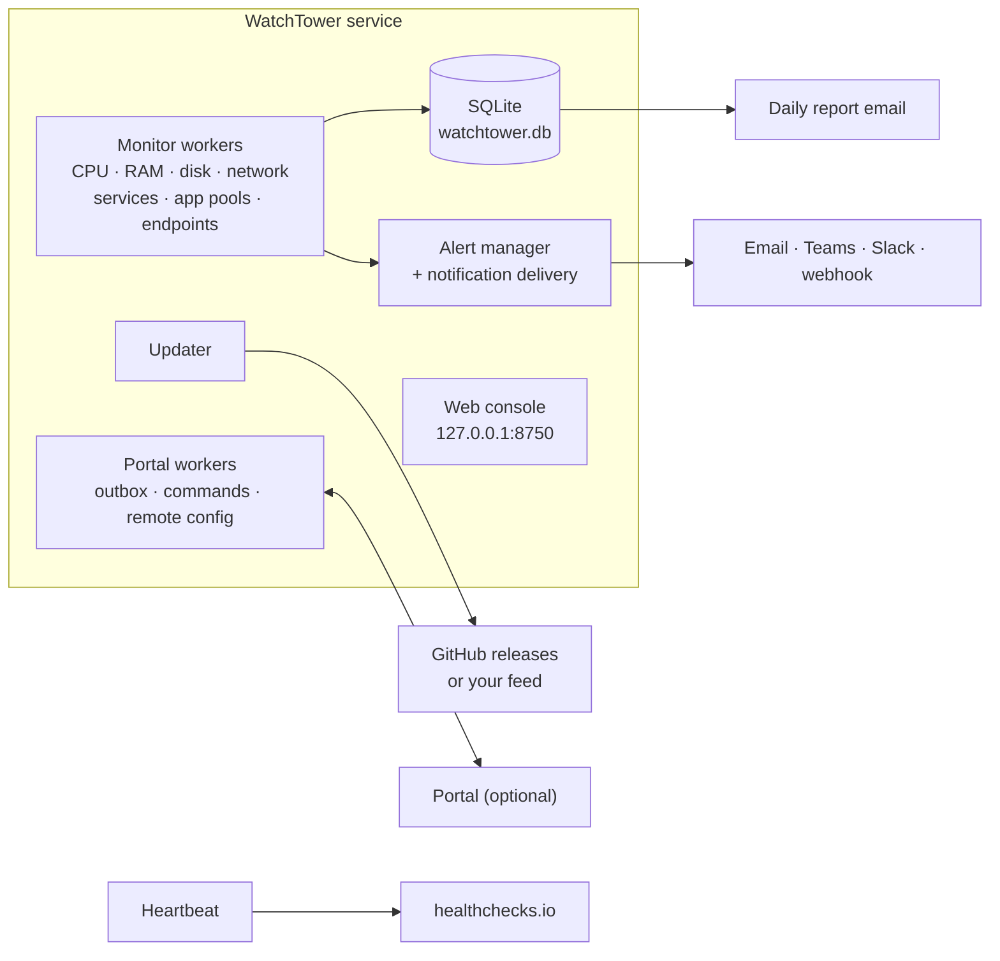

<p align="center">
  
</p>

<h1 align="center">WatchTower</h1>

<p align="center">
  <strong>A Windows service that watches a server's vitals, services, IIS application pools and endpoints, fixes what it can, and tells you about the rest.</strong>
</p>

<p align="center">
  <a href="https://github.com/angatiabenson/watch-tower/actions/workflows/ci.yml"></a>
  <a href="https://github.com/angatiabenson/watch-tower/actions/workflows/release.yml"></a>
  
  
  
  <a href="LICENSE"></a>
</p>

---

## Contents

- [What is WatchTower?](#what-is-watchtower)
- [Quick start](#quick-start)
- [The web console](#the-web-console)
- [Updates](#updates)
- [Connecting to a portal](#connecting-to-a-portal)
- [Features](#features)
  - [Monitoring](#monitoring) · [Spike detection](#spike-detection) · [Service and application pool recovery](#service-and-application-pool-recovery) · [Daily reports](#daily-reports)
  - [Alerts](#alerts-that-operators-can-trust) · [Notification channels](#notification-channels) · [Maintenance windows](#maintenance-windows) · [Endpoint checks](#endpoint-checks)
  - [Dead man's switch](#dead-mans-switch) · [Stale readings](#stale-readings) · [Data directory and persistence](#data-directory-and-persistence)
- [Configuration](#configuration)
- [CLI reference](#cli-reference)
- [Architecture](#architecture)
- [Building from source](#building-from-source)
- [Upgrading from an old WatchTower](#upgrading-from-an-old-watchtower)
- [Incident types](#incident-types)
- [Logs](#logs)
- [Testing](#testing)
- [Tech stack](#tech-stack)
- [Security](#security)
- [License](#license)

---

## What is WatchTower?

WatchTower is a .NET 10 agent that runs as a Windows service on each server. It:

- **monitors** CPU, memory, disk space, disk I/O queues and network output queues;
- **watches** Windows services and IIS application pools, and starts them again when they stop;
- **checks endpoints**: HTTP status and content, TCP ports and TLS certificate expiry;
- **alerts** by email, Microsoft Teams, Slack or a signed webhook, with reminders, recoveries
  and maintenance windows, and sends a **daily HTML report**;
- pings a **dead man's switch** (e.g. healthchecks.io), so you hear about it if WatchTower itself stops;
- is configured from a **local web console** and **updates itself** from GitHub releases (or
  your own feed), checking each package's SHA-256 and, when the release was signed (the
  `WATCHTOWER_SIGNING_KEY` secret is configured) and `Updates:PublicKey` is set, its signature.

It works **standalone** (the default), or **attached to a portal** that collects metrics and
alerts from many servers and sends commands back. The agent only makes outbound calls over a
small, public, versioned API, so the portal can be ours or one you build yourself
([Build your own portal](#build-your-own-portal)).

---

## Quick start

Requirements: Windows Server 2016+ or Windows 10+ (x64). No .NET installation is needed: the
release zip contains a self-contained `WatchTower.exe`.

**One line**, in an elevated PowerShell (Windows PowerShell 5.1 or PowerShell 7):

```powershell
& ([scriptblock]::Create((irm https://github.com/angatiabenson/watch-tower/releases/latest/download/get-watchtower.ps1)))
```

[`get-watchtower.ps1`](build/get-watchtower.ps1) looks up the latest release, downloads
`WatchTower-<version>-win-x64.zip` and `SHA256SUMS.txt` over HTTPS (TLS 1.2+), **stops without
installing anything if the zip's SHA-256 doesn't match**, extracts it to a new temporary folder,
runs its `install.ps1` (step 2 below) and deletes the temporary folder. Every
[`install.ps1` parameter](#install-parameters) passes straight through, and `-Version 1.0.20`
picks a release:

```powershell
& ([scriptblock]::Create((irm https://github.com/angatiabenson/watch-tower/releases/latest/download/get-watchtower.ps1))) -InstallDir C:\Services\WatchTower -EnrollmentCode WT1.eyJ2IjoxLC...
```

The checksum comes from the same release as the zip: it catches a damaged or swapped download,
not a compromised release. To read the script before running it, download it, read it, then run
the file:

```powershell
irm https://github.com/angatiabenson/watch-tower/releases/latest/download/get-watchtower.ps1 -OutFile get-watchtower.ps1
notepad get-watchtower.ps1      # read it; its own SHA-256 is in the release's SHA256SUMS.txt too
.\get-watchtower.ps1 -InstallDir C:\Services\WatchTower
```

On an older Windows PowerShell without TLS 1.2 enabled, run
`[Net.ServicePointManager]::SecurityProtocol = [Net.ServicePointManager]::SecurityProtocol -bor 3072`
first (the script does this itself, but `irm` fetches it before it runs).

**Or manually:**

1. **Download** `WatchTower-<version>-win-x64.zip` from the
   [latest release](https://github.com/angatiabenson/watch-tower/releases/latest) and extract it
   on the server (e.g. to `C:\Temp\WatchTower`). `SHA256SUMS.txt` in the release has its checksum
   (`Get-FileHash .\WatchTower-<version>-win-x64.zip`).
2. **Install** from an elevated PowerShell:

   ```powershell
   powershell -ExecutionPolicy Bypass -File .\install.ps1
   ```

   This copies the binaries to `C:\Program Files\WatchTower`, creates the data directory
   `C:\ProgramData\WatchTower`, registers the `WatchTower` service (delayed automatic start,
   restarted automatically after a failure), asks for a console password (at least 10
   characters) if none is set yet, starts the service and prints its status. Re-running it from
   a newer zip upgrades in place, and a failed install restores the previous version.

   Unattended and fleet installs (GPO, Intune, SCCM, Ansible, `Invoke-Command`):

   ```powershell
   # Connect to a portal in the same step (code from the portal's "Add server" dialog)
   .\install.ps1 -EnrollmentCode WT1.eyJ2IjoxLC... -AdminPassword $securePassword

   # Or import settings from a seed file (same keys as appsettings.json; secrets are encrypted)
   .\install.ps1 -ConfigFile .\watchtower.seed.json -AdminPassword $securePassword
   ```

   <a id="install-parameters"></a>

   | Parameter | Default | |
   |---|---|---|
   | `-InstallDir` | `C:\Program Files\WatchTower` | Where the binaries go |
   | `-DataDir` | `C:\ProgramData\WatchTower` | Settings, database and logs |
   | `-ServiceName` | `WatchTower` | Change only to run several instances side by side |
   | `-ConfigFile` | – | JSON settings to import, validated before anything is changed |
   | `-EnrollmentCode` | – | `WT1.…` code that connects the agent to a portal |
   | `-AdminPassword` | prompted | Console password (`SecureString`) |
   | `-NoStart` | – | Don't start the service afterwards |
   | `-OpenConsole` | – | Open the console in the browser when done |

3. **Open the console.** Its address is printed by the installer and by
   `WatchTower.exe status`. `WatchTower.exe open` and the Start-menu shortcut
   **WatchTower Console** open it in the browser. By default it is `http://127.0.0.1:8750`,
   reachable from the server only.
4. **Sign in.** Without a password (an unattended install without `-AdminPassword`), the first
   visit from the server itself asks you to create one. To set or reset it at any time:

   ```powershell
   & 'C:\Program Files\WatchTower\WatchTower.exe' set-password
   ```

Then configure email and channels, services, pools, disks and endpoint checks in the console.
[build/INSTALL.txt](build/INSTALL.txt) (also in the zip) is the short version of this section.

---

## The web console

The service hosts its own console (Kestrel; HTML, JS and fonts embedded in the exe, no CDNs):

- **Dashboard**: CPU and memory charts, disks, disk queues, network adapters, services,
  application pools, endpoint results, open alerts, recent incidents, configuration warnings
  and the maintenance banner. Readings that are no longer current are shown as stale and left
  out of the health counts.
- **Logs**: the latest lines of the current log file.
- **Configuration**: one section per area, each field showing where its value comes from
  (default, console, portal or environment variable; values set by the portal or an environment
  variable are read-only):

  | Section | What you set |
  |---|---|
  | General | Daily report time, display time zone and label |
  | Alerting | Reminder interval, recovery notices, full report in alert emails |
  | Maintenance window | Start or end a window (also from the dashboard) |
  | Notification channels | Email on/off, Teams, Slack and webhook URLs, minimum severities, *Send test notification* |
  | Email alerts | SMTP server, security, credentials, sender, recipients, *Send test email* |
  | CPU, Memory, Disks, Network | Thresholds, sustained times and poll intervals |
  | Windows services, IIS application pools | Watch lists (with a picker of the server's services and pools) and restart behaviour |
  | Endpoint checks | HTTP, TCP and certificate checks (add, edit, remove) |
  | Dead man's switch | Ping URL and interval |
  | Visibility Portal | Enrollment code, portal URL, agent ID and token, protocol, remote configuration, TLS |
  | Web console | Listen URLs, remote access, HTTPS certificate, allowed host names, session timeout |
  | Updates | Automatic checks, channel, background download, countdown, feed, signing key |
  | Logging | Log level |

- **Updates**: check, download, install, cancel the countdown, last result (see [Updates](#updates)).
- **Account**: change the password (signs out every other session).

Changes take effect within about a second; the few fields marked *restart required* (the
portal connection, where and how the console listens, the log level) show a *Restart now*
prompt.

### Security defaults

- Listens on **`127.0.0.1:8750` only**.
- **Password** sign-in (PBKDF2 hash in the settings file); the first password can only be set
  from the server itself or with `set-password`. Sign-in is rate-limited (10 attempts per 5
  minutes per IP) and sessions end after 30 idle minutes (`Ui:SessionTimeoutMinutes`).
- **CSRF**: the session cookie is `HttpOnly` and `SameSite=Strict`, and every state-changing API
  call must carry `X-WatchTower-Request: 1`; an `Origin` header, when present, must match the request's
  scheme, host and port.
- **Host guard** against DNS rebinding: connections from the server must address it as
  `127.0.0.1`, `localhost` or `[::1]`; remote connections can be limited to `Ui:AllowedHosts`.
- Content Security Policy `default-src 'self'`.

### Remote access

Opt in under *Web console* (advanced fields), then restart:

```json
{ "Ui": {
    "AllowRemoteAccess": true,
    "Urls": [ "http://127.0.0.1:8750", "https://0.0.0.0:8751" ],
    "CertificateThumbprint": "<thumbprint of a certificate in LocalMachine\\My>",
    "AllowedHosts": [ "srv-01.corp.local" ] } }
```

A non-loopback URL is ignored unless `Ui:AllowRemoteAccess` is on, and it must be `https://`
with `Ui:CertificateThumbprint` set unless you turn off `Ui:RequireHttpsForRemoteAccess` (plain
HTTP; the password and session then cross the network unencrypted). A URL that is invalid or
whose port is taken is skipped with a warning; it never stops monitoring. The console's own
HTTP API is documented in [src/WatchTower/Ui/API.md](src/WatchTower/Ui/API.md).

---

## Updates

Servers **pull** releases; nothing is pushed to them. Every push to `main` that changes the
product publishes a release on GitHub (see [Releasing](#releasing)), and each agent's built-in
updater picks it up:

1. **Check**: every `Updates:CheckIntervalHours` (6) on the `Updates:Channel` (`stable` or
   `prerelease`), or on demand (*Check for updates*).
2. **Download**: on a click (*Download update*), a portal command (`AgentUpdate`, 304, with an
   optional `Version` guard), or in the background with `Updates:AutoDownload`. The package is
   verified against its **SHA-256** and, when `Updates:PublicKey` is set (ECDSA P-256, PEM),
   its **signature**; a package that fails either check is rejected.
3. **Countdown**: after a download started from the console or the portal, a restart countdown
   (`Updates:RestartCountdownSeconds`, 30) runs in the service and can be cancelled from any
   console session; *Install now* skips it. A background download waits for a
   click.
4. **Install**: a helper started from the new exe stops the service, backs up the install
   folder, copies the new files, starts the service and waits up to
   `Updates:HealthTimeoutSeconds` (120) for the new version to report healthy. Otherwise it
   **rolls back** to the backup. Each step goes to `Logs\update-<date>.log`, and the console
   shows the outcome after the restart.

**Feeds** (`Updates:FeedUrl`): the GitHub releases API of this repository (the default; each
release carries a `watchtower-update.json` manifest), another releases API URL, or the URL of
your own `watchtower-update.json` for self-hosted distribution. Feeds and packages must use
HTTPS unless `Updates:RequireHttps` is turned off (then also set `Updates:PublicKey`). Updates
install only when WatchTower runs as a Windows service.

---

## Connecting to a portal

WatchTower runs standalone until you connect it (`VisibilityPortal:Enabled`, default `false`).
Connected, it streams metrics and alert events to the portal, polls for commands, and accepts
remote configuration (thresholds, intervals, watch lists, portal timings and a maintenance
window) unless *Allow the portal to manage settings* is turned off. Turning it off stops both
configuration polling and the *Apply configuration* command (401); settings the portal applied
earlier stay in effect until the portal file is removed. Endpoint checks and notification channels
stay local.

The simplest way is an **enrollment code** from the portal's *Add server* dialog: `WT1.`
followed by base64url JSON `{v, url, agentId, token, requireTls}`. Use it in any of these:

```powershell
WatchTower.exe enroll WT1.eyJ2IjoxLC...          # saves it and restarts the service if running
WatchTower.exe enroll WT1.eyJ2IjoxLC... --check  # only validate the code
.\install.ps1 -EnrollmentCode WT1.eyJ2IjoxLC...  # during installation
```

or paste it into *Configuration → Visibility Portal → Connect with an enrollment code*. The
token is stored encrypted. Without a code, set `VisibilityPortal:BaseUrl`, `AgentId`,
`AgentToken` and `Enabled` in the console or in a seed file (`install.ps1 -ConfigFile`,
`WatchTower.exe config import`).

The connection uses **HTTPS by default** (`VisibilityPortal:Tls:RequireTls`). Plain HTTP must be
allowed explicitly (*Require HTTPS* off, or a code made for an `http://` portal) and is logged
as a warning, because the token then travels unencrypted. An optional client certificate
(`VisibilityPortal:Tls:ClientCertThumbprint`) enables mutual TLS, and
`VisibilityPortal:Protocol` can switch to gRPC for portals that offer it (enrollment codes
always use HTTPS/JSON).

**Compressed requests** (`VisibilityPortal:CompressRequests`, console *Compress requests*):
`Off` by default; `Gzip` gzips the metrics batches and events (`Content-Encoding: gzip`, or gRPC's
`grpc-encoding: gzip`), about five times smaller (a typical 30-second batch goes from ~7 KB to
~1.3 KB, ~21 MB to ~4 MB a day). Enrolling with a code that says `acceptsGzip` turns it on; no
code turns it off. Only enable it for a portal that accepts compressed requests. If the portal
refuses one (415), the agent resends it uncompressed, logs *Portal does not accept compressed
requests; sending uncompressed* once and stays uncompressed until the service restarts or the
setting changes; nothing is lost or sent twice.

Portal commands: start, stop and restart services and pools (only those watched in the
agent's own settings, unless `VisibilityPortal:CommandPoll:AllowPortalManagedTargets` is on;
never WatchTower itself), recycle a pool, force a metrics snapshot or a configuration sync,
restart or update the agent, apply a configuration, and send a test notification. Commands
with `issuedAt` are checked for freshness; set `VisibilityPortal:RequireCommandIssuedAt=true` to
reject commands without it. A command ID is never run twice while it is remembered (365 days and
at most 200,000 IDs by default), so portals must never reuse IDs.

### Build your own portal

The agent reports to a portal over a small, public, versioned HTTPS/JSON API (v1). It only
makes outbound calls: it pushes metrics and events, and it polls for commands and remote
configuration. Anyone can build a compatible portal, in any language:

- [Portal API guide](guides/portal-api/README.md): concepts, a quickstart, one page per endpoint,
  telemetry, alerts, commands, remote configuration, reliability, testing and versioning
- [OpenAPI 3.1 spec](spec/portal-agent-api.v1.openapi.yaml), with the
  [changelog](guides/portal-api/CHANGELOG.md) of the contract
- [MinimalPortal](samples/MinimalPortal/README.md): a runnable reference portal
- [AgentSimulator](samples/AgentSimulator/README.md): agent traffic from Linux, macOS or Windows,
  including a conformance check of your portal

---

## Features

### Monitoring

| What | Default poll | Default threshold | Alert |
|---|---|---|---|
| **CPU** | 5 s | 99 % sustained for 5 min | Critical, with the top processes |
| **Memory** | 5 s | 90 % sustained for 5 min | Critical, with the top processes |
| **Disk space** | 60 s | 70 % warning (logged), 85 % critical | Critical, per drive |
| **Disk queue length** | 60 s | > 2 per disk | Warning: the disk can't keep up |
| **Network output queue** | 30 s | > 0 per adapter | Warning: the adapter is saturated |
| **Windows services** | 30 s | Stopped | Restarted automatically; critical if that fails |
| **IIS application pools** | 30 s | Stopped | Started automatically; critical if that fails |
| **Endpoints** | 60 s per check | Failing, or certificate expiring | See [Endpoint checks](#endpoint-checks) |

Every value is configurable in the console. Run the `Get-Counter` commands
`\PhysicalDisk(*)\Current Disk Queue Length` and `\Network Interface(*)\Output Queue Length`
during peak hours to find good thresholds: about 2 suits SSD/NVMe disks, 4 to 5 spinning disks,
and 0 is right for the network queue on most servers.

### Spike detection

CPU or memory above the threshold for less than the sustained window is not an emergency, but
it is still recorded as a **spike incident** for the daily report, with the time and the
processes using the most of that resource at that moment (no notification).

### Service and application pool recovery

When a watched service stops (use the service *name*, e.g. `MSSQLSERVER`, not its display name;
the console has a picker), WatchTower waits `RestartDelaySeconds` (10), restarts it, checks that
it stays running, and records the restart. After `MaxRestartAttempts` (3) failed attempts it
raises a critical alert. Reports use display names. Right after WatchTower starts
(`StartupGraceSeconds`, 120), stopped services are recorded but not restarted, so a reboot can
settle. Stopped IIS application pools are started the same way (`Monitoring:ApplicationPools`:
`StartDelaySeconds`, `MaxStartAttempts`). Nothing is restarted automatically during a
[maintenance window](#maintenance-windows).

### Daily reports

An HTML email at `Reporting:DailyReportTime` (08:00 in `Display:Timezone`, default
Africa/Nairobi, labelled EAT) with CPU and memory min/avg/max, disk queues and network queues,
per-drive usage bars, service and pool status, and the day's incidents with their top
processes. A failed send is retried after 5, 15, 30 and 60 minutes. Only once a report was
delivered are the samples and incidents it covered deleted (CPU and memory samples only after
the portal has them, when connected); current state and alert state are kept. Without a
delivered report, history older than 48 hours is purged instead.

### Alerts that operators can trust

Every problem WatchTower detects is an **alert** with a stable key — `cpu`, `ram`,
`disk:C:\`, `diskqueue:<instance>`, `net:<interface>`, `svc:<service>`,
`pool:<app pool>`, `endpoint:<name>` — and a lifecycle that survives restarts (SQLite
table `alert_state`, untouched by the daily report purge):

- **Opened**: the first time the condition is seen, the incident is recorded, sent to the
  portal and a notification goes out.
- **Still open**: nothing new is recorded; a reminder is sent every
  `Alerting:RenotifyMinutes` (default 60, `0` = never). A higher severity (e.g. a
  certificate that was expiring is now expired) escalates and notifies again.
- **Resolved**: when the condition clears, a "resolved" notification says how long it
  lasted (`Alerting:SendRecovery`, default `true`). CPU, RAM, disk, disk-queue and network
  alerts resolve only after staying clear for `Alerting:ResolveAfterSeconds` (default 300),
  so values hovering around a threshold do not flap.
- An alert that was open before a restart is **not** re-sent.
- **Opened again**: each time a resolved alert opens again it is a new *occurrence*
  (`alert_state.occurrence`; every pending notice in `alert_delivery` records the occurrence it
  is about). An alert's notices form a queue, ordered by occurrence and then creation, and are
  sent one at a time: a new occurrence never replaces an earlier one's recovery, so every
  opening that may have reached operators gets its own resolved notice, before the next
  occurrence's opening. Each channel goes through the queue on its own: a notice goes to a
  channel only once every earlier notice of the alert has reached that channel, was skipped
  there or was given up, so every channel gets them in order, also across a restart, while the
  channels that work are never held back by one that fails. An opening that could not go out
  because its channels keep failing still gets its resolved notice once they work again.
- **Flapping**: at most 5 notices are queued per alert. When an alert keeps opening and
  clearing faster than its notices can go out (a channel down, a maintenance window), the 3
  oldest are kept, the new notice is the alert's latest state, and everything in between is
  folded into one persisted resolved notice, "Flapping: N occurrences between T1 and T2" (merged
  with the previous one if the alert keeps flapping), sent in their place to every channel that
  missed one of them. In a maintenance window it becomes a line of the end-of-window summary
  unless one of the folded occurrences may have reached operators.
- **Retired**: when a service, application pool or endpoint check is removed from the
  configuration (checked at startup and on every poll, so a config change takes effect
  within one poll interval), its open alert is closed with a retirement reason (e.g.
  `removed from Monitoring:Services:WatchedServices`), stored in `alert_state.retired_reason`
  and sent as a resolved notice with `retiredReason` in the webhook body.

CPU/RAM spike incidents are still recorded (without notifying) for the daily report.

Alert emails are short (title, description, server, times, top processes). Set
`Alerting:IncludeFullReport: true` to attach the full 24-hour server report as well.

### Notification channels

Alerts go to every enabled channel whose `MinSeverity` (`Info` | `Warning` | `Critical`,
default `Info`) the alert meets. Channels are sent in parallel with a short timeout
(`Notifications:TimeoutSeconds`, default 10); a failing channel is logged by name and type
(never its URL) and does not block the others.

| Channel | Configure (console: *Notification channels*) | Payload |
|---|---|---|
| Email | `Notifications:Email:Enabled` (default `true`) + the `Email` SMTP settings | Short HTML alert |
| Microsoft Teams | `Notifications:Teams:Url`: a Teams *Workflows* "Post to a channel when a webhook request is received" URL | Adaptive Card |
| Slack | `Notifications:Slack:Url`: an incoming-webhook URL | Block Kit |
| Webhook | `Notifications:Webhook:Url` (+ optional `Secret`) | JSON (`schema: "watchtower.alert.v1"`) |

Webhook URLs and secrets are stored DPAPI-encrypted and never returned by the console API.
With a secret, every webhook request carries
`X-WatchTower-Signature: sha256=<hex HMAC-SHA256(secret, raw request body)>` and
`X-WatchTower-Event: opened|reminder|resolved|event|test`. Webhook body:

```json
{ "schema": "watchtower.alert.v1", "kind": "opened", "alertKey": "disk:C:\\", "severity": "critical",
  "title": "Disk Critical: C:\\ at 91.0%", "description": "Drive C:\\ at 91.0% (9.7 GB free of 126.5 GB)",
  "server": "SRV-01", "occurredAt": "2026-11-03T08:10:00Z", "openedAt": "2026-11-03T08:10:00Z",
  "durationSeconds": 0, "notifyCount": 1, "incidentType": "DiskCritical" }
```

Text that comes from the monitored server (service and process names, HTTP reason phrases,
descriptions) is never rendered as markup: Teams cards backslash-escape Markdown, and Slack
messages carry it in `plain_text` blocks with the fallback text sent as `"mrkdwn": false`.

**More channels** (several Teams channels, a Slack channel for critical alerts only, a second
webhook) go in the `Notifications:Channels` list. The console doesn't edit this list, so import
it with `WatchTower.exe config import channels.json` (validated first; URLs and secrets are
encrypted). An entry named `email`, `teams`, `slack` or `webhook` replaces that fixed channel:

```json
{ "Notifications": { "Channels": [
  { "Name": "oncall-slack", "Type": "Slack", "Url": "https://hooks.slack.com/services/...", "MinSeverity": "Critical" },
  { "Name": "itsm", "Type": "Webhook", "Url": "https://itsm.example/hooks/watchtower", "Secret": "...", "Enabled": true }
] } }
```

Test the setup from the console (*Send test notification*, `POST /api/actions/test-notification`)
or from the portal (action `SendTestNotification` = 501, optional parameter `Channel`).

<details>
<summary><strong>Delivery guarantees</strong>: per-channel tracking, retries, fair scheduling and failing channels</summary>

Delivery is tracked per channel (SQLite table `alert_delivery`, kept across restarts). When a
notification is created, the channels it is owed to are fixed and stored with it: the channels
configured at that moment whose `MinSeverity` it meets. A configuration change never adds a
channel to a queued notification; a channel added (or a filter lowered) later only gets
notifications created after the change. A channel removed from the configuration, or whose
`MinSeverity` now excludes a queued notification, is recorded as skipped for it (restoring the
setting does not bring it back, because the alert's later notices may already have gone there).

A channel that failed is retried with backoff (1, 2, 4, 8, 16, then every 30 minutes), each
notification on its own schedule; the channels that already have the notification never get
it twice. Opened and reminder notices are retried while their alert stays open; resolved notices
and one-shot events for up to 24 hours after their first attempt. An alert only counts as
notified (`notifyCount`, `lastNotifiedAt`) once a notice actually reached a channel.

**Fair scheduling.** Every send, the first attempt of a new alert as much as a retry, goes
through the same per-channel scheduler; a new alert never jumps the queue. When a channel can
take an attempt, it gets the next notice it is owed that is allowed by the per-alert ordering
above, choosing the highest priority first (critical, then warning, then info; a recovery
counts as the severity of the alert it resolves, and a notice holding back a more severe one of
the same alert counts as that one), then the oldest. A waiting notice gains one priority level
every 5 minutes, so under a constant stream of critical alerts an info notice still goes out
after at most 10 minutes (and then by age). A channel that works takes up to 20 notifications
at once and one more every 2 seconds, with at most 4 in flight, so a backlog drains without
flooding it, and a critical alert queued behind that backlog goes out with the next attempt
the channel can take.

**Failing channels.** A failing channel is also backed off as a whole, across every alert:
after a failure it is not attempted at all until its backoff has passed, then with a single
probe; a success resumes normal delivery. While a channel backs off, a *new* critical alert (or
the recovery of one) may probe it early, at most once per `Notifications:CriticalProbeCooldownSeconds`
(default 120, 60–3600) per channel; the probe carries the channel's next notice by the rules
above, so the order is kept, and if it succeeds the channel drains at once instead of after up
to 30 minutes. Worst case for a channel that stays down, however many alerts open, flap or wait
for it: at most 9 attempts in its first hour and 2 an hour after that, plus at most one
critical probe per cooldown (30 an hour at the default) and only while new critical alerts keep
coming. The backoff is kept in `agent_state` across restarts.

Backoffs and retry deadlines are measured on the monotonic clock while the agent runs, so
changing the system clock neither shortens nor extends them. Their UTC times are persisted only
for a restart, and on restore every one (each channel's backoff and each notification's retry)
is clamped to now + its backoff (30 minutes at most): a clock set back while the agent was down
cannot make it wait longer, and a clock that jumped ahead makes the retries due but the
channel's single probe still paces them.

</details>

### Maintenance windows

```powershell
WatchTower.exe maintenance start --minutes 90 --reason "Monthly patching"
WatchTower.exe maintenance stop
```

This sets `Maintenance:Until` (UTC) / `Maintenance:Reason` in the operator settings (the
console can do the same from the dashboard, and the portal can push
`maintenance: { untilUtc, reason }`, at most 7 days ahead, which takes precedence). During the
window incidents are still recorded and sent to the portal, but **notifications are held** and
**services / application pools are not restarted automatically** (checked again right before
each automatic start, so a window that opens during the restart delay still prevents it). When
the window ends (also after an agent restart), what was held is delivered: alerts still open
notify once, alerts that had notified before the window send their resolved notice, and
everything else (alerts that opened and cleared inside the window, the patch reboot) arrives as
one "Maintenance ended: N held notifications" summary (alert key `maintenance`).

### Endpoint checks

`Monitoring:Endpoints` checks what the server serves. Edit the checks in the console
(*Configuration → Endpoint checks*); they apply without a restart. The results appear on the
dashboard and go to the portal.

| Field | Default | |
|---|---|---|
| `Name` | – | Unique; alert key `endpoint:<Name>` |
| `Type` | `Http` | `Http` (GET), `Tcp` (connect), `Certificate` (TLS handshake, days until expiry) |
| `Target` | – | Http: URL · Tcp: `host:port` · Certificate: `host`, `host:port` (443) or an https URL |
| `TimeoutSeconds` | 10 | 1–120 |
| `ExpectStatus` | `200-399` | Http: e.g. `200`, `200,204,301-302` |
| `ExpectBodyContains` | – | Http: required text (case-sensitive) |
| `CertificateWarnDays` | 21 | Certificate: warn when fewer days are left |
| `IntervalSeconds` | 60 | 5–86400 |
| `FailuresBeforeAlert` | 2 | Consecutive failures before the endpoint is reported down |

An endpoint alerts *Critical* (`EndpointDown`) after `FailuresBeforeAlert` failures (an
invalid or expired certificate counts as a failure), *Warning* (`CertificateExpiring`) as
soon as a certificate is inside its warning window, and resolves (`EndpointRecovered`) when
the check passes. HTTP redirects are followed at most 5 times and only within the same host.
A check whose configuration becomes invalid stops running (its alert is retired) but keeps its
last result, reported with status `ConfigurationError` and the reason in its detail, until it
is fixed (it then runs at once) or removed. Names are case-insensitive: renaming `Site` to
`site` keeps its last result and schedule.

The list can also be imported, e.g. when provisioning many servers
(`WatchTower.exe config import endpoints.json`, validated first). The imported list replaces
the current one:

```json
{ "Monitoring": { "Endpoints": [
  { "Name": "intranet", "Type": "Http", "Target": "https://intranet.example/health", "ExpectBodyContains": "OK" },
  { "Name": "intranet-tls", "Type": "Certificate", "Target": "intranet.example" },
  { "Name": "sql", "Type": "Tcp", "Target": "db01:1433", "IntervalSeconds": 30 }
] } }
```

Endpoint checks are configured locally only; the portal can't push them.

### Dead man's switch

Set `Heartbeat:Url` (e.g. a [healthchecks.io](https://healthchecks.io) ping URL, stored
encrypted) and WatchTower pings it every `Heartbeat:IntervalSeconds` (600, i.e. 10 minutes).
If the pings stop (WatchTower crashed, the server is down, the network is out), the external
monitor alerts you.

The ping is **health-gated**: each monitor worker reports every successful cycle, and when
any of them has had none for 3× its poll interval (at least 2 minutes) WatchTower pings
`<url>/fail` instead, with the stalled workers as the reason, so a hung monitor is noticed
even though the process is still running. The console dashboard lists stalled workers too. After a
server restart WatchTower also sends a one-off "Server restarted at …" notification (Warning;
Info if WatchTower had been stopped cleanly first).

### Stale readings

A drive, disk, network adapter, service, pool or endpoint check that is still configured but
can no longer be read keeps its last reading. Once that reading is older than its freshness
window it is marked **stale**: max(3 × the monitor's poll interval, 10 min), or for an endpoint
check max(2 × its interval + its timeout, 10 min). The console greys it out and leaves it out
of the health counts, the metrics batches sent to a portal carry `isStale: true`, and the log
gets one warning when an entry goes stale (at most once an hour per resource) and an
information message when it is read again. See
[Staleness](guides/portal-api/06-telemetry-reference.md#staleness-isstale).

### Data directory and persistence

Binaries live in the install folder and are replaced by upgrades. Everything that changes lives
in the **data directory**, `%ProgramData%\WatchTower` by default:

```text
C:\ProgramData\WatchTower\
  watchtower.db                    SQLite (WAL): metrics, incidents, alert state, notification
                                   queue, portal outbox, commands
  config\watchtower.settings.json  operator settings (console, CLI, installer)
  config\remote-config.json        settings pushed by the portal
  state\                           health beacon, last-report marker
  Logs\                            service, startup and update logs
  updates\                         downloaded packages, last update result
```

- **Location**: `install.ps1 -DataDir` or `WatchTower.exe install --data-dir <path>` records it
  in the service registration. Management commands use `--data-dir` when given, else the
  installed service's directory, else the `WATCHTOWER_DATA_DIR` environment variable, and
  finally `%ProgramData%\WatchTower` (`<exe folder>\data` when `DOTNET_ENVIRONMENT=Development`).
- **Permissions**: restricted to SYSTEM and Administrators, re-applied on every start
  (links inside the tree are removed, never followed). The service refuses to start if it can't
  apply them.
- **Secrets** (SMTP password, agent token, heartbeat URL, Teams/Slack/webhook URLs and webhook
  secrets) are stored encrypted with Windows DPAPI (machine scope, `dpapi:` prefix). A secret
  written by hand in plain text is encrypted at the next start. A settings file copied to another
  machine can't decrypt them; the console then shows a warning, and the values must be entered
  again.
- **Persistence**: metrics, alert state, queued notifications, the portal outbox and command
  history survive restarts, upgrades and reboots.

---

## Configuration

The console is the primary way to configure WatchTower. Underneath, settings come from four
layers, each overriding the one before:

| Layer | File | Written by |
|---|---|---|
| 1. Shipped defaults | `appsettings.json` in the install folder (plus `appsettings.<Environment>.json`) | Each release; replaced on upgrade, don't edit it |
| 2. Operator settings | `config\watchtower.settings.json` in the data directory | The console, `config import`, `set-password`, `enroll`, `maintenance`, the installer |
| 3. Portal settings | `config\remote-config.json` in the data directory | The portal's remote configuration (when allowed) |
| 4. Environment variables | `Section__Key`, or `WATCHTOWER_Section__Key` (wins) | You (e.g. automation) |

A list in a higher layer replaces the lower list entirely (it isn't merged by index), and the
console shows which layer supplied each value. Files are reloaded when they change. A file
(`config import`, `install --config`, the installer's `-ConfigFile`) is validated against the
resulting configuration before anything is written, and the service also validates the whole
configuration at startup.

Main sections (all in the console; defaults in
[appsettings.json](src/WatchTower/appsettings.json)):

| Section | Contents |
|---|---|
| `Monitoring:Cpu`, `Ram`, `Disk`, `Network` | Poll intervals, thresholds, sustained times, top-process counts |
| `Monitoring:Services`, `ApplicationPools` | Watch lists, restart/start attempts, delays, timeouts, startup grace |
| `Monitoring:Endpoints` | Endpoint checks |
| `Email` | `SmtpHost`, `SmtpPort` (587), `Security` (`StartTls`, `Ssl`, `None`, `Auto`), `Username`, `Password`, `FromAddress`, `FromName`, `ToAddresses` |
| `Reporting`, `Display` | Daily report time; time zone and its label |
| `Alerting`, `Notifications`, `Maintenance` | Alert lifecycle, channels, maintenance window |
| `Heartbeat` | Dead man's switch URL and interval |
| `VisibilityPortal` | Portal connection, TLS, outbox, command and remote-config polling, replay protection |
| `Ui` | Console listen URLs, remote access, certificate, allowed hosts, session timeout |
| `Updates` | Self-update settings |
| `Serilog` | Logging |

For Gmail, enable 2-Step Verification and use an
[app password](https://myaccount.google.com/apppasswords) with `smtp.gmail.com`, port 587,
`StartTls`.

---

## CLI reference

`WatchTower.exe` without a command runs the monitor (what the service does; `Ctrl+C` stops it
in a console). Every command accepts `--data-dir <path>` and `--service-name <name>` (default
`WatchTower`). Commands that change the service or the settings need an elevated prompt.

| Command | Description |
|---|---|
| `install [--config <file>] [--start]` | Register WatchTower as a Windows service running from this folder, prepare the data directory and create the Start-menu shortcut |
| `uninstall [--purge-data]` | Stop and remove the service; `--purge-data` also deletes the data directory (refused for unsafe paths) |
| `start` | Start the service |
| `stop` | Stop the service |
| `restart [--delay <s>]` | Restart the service |
| `status` | Show service state, version, file locations and the web console address |
| `open` | Open the web console in the default browser |
| `version` | Print the WatchTower version |
| `config import <file>` | Merge a JSON settings file into the operator settings (validated first; secrets are encrypted) |
| `config validate <file>` | Check that merging a JSON settings file would produce a valid configuration, without writing anything |
| `config path` | Print the operator settings file path |
| `set-password [--password-stdin]` | Set or reset the web console administrator password (signs out existing sessions) |
| `enroll <code> [--check] [--no-restart]` | Connect this server to a portal using an enrollment code |
| `maintenance start --minutes <n> [--reason <text>]` | Start a maintenance window (1 to 10080 minutes) |
| `maintenance stop` | End the maintenance window now; alerts still open notify once |
| `apply-update …` | Internal (hidden): installs a staged update; started by the service |
| `import-legacy --from <folder>` | Internal (hidden): imports settings and state from an old installation folder; used by `install.ps1` |

---

## Architecture



Each monitor is an independent `BackgroundService`: `CpuMonitorWorker`, `RamMonitorWorker`,
`DiskMonitorWorker`, `NetworkMonitorWorker`, `ServiceMonitorWorker`,
`ApplicationPoolMonitorWorker` and `EndpointMonitorWorker`. Alongside them run
`NotificationDeliveryWorker`, `EmailReporterWorker` (daily report), `HeartbeatWorker`,
`RebootDetectionWorker`, `StaleSnapshotWorker`, `UpdateWorker` and, when a portal is connected,
`OutboxDispatchWorker`, `CommandPollingWorker` and `RemoteConfigWorker`.

---

## Building from source

Requirements: Windows and the .NET 10 SDK (version pinned in [global.json](global.json), which
also selects the Microsoft.Testing.Platform test runner).

```powershell
git clone https://github.com/angatiabenson/watch-tower.git
cd watch-tower

dotnet build WatchTower.slnx
dotnet test --project tests/WatchTower.Tests/WatchTower.Tests.csproj
dotnet format WatchTower.slnx                     # CI runs it with --verify-no-changes

dotnet run --project src/WatchTower               # run in a console (Development: data in <bin>\data)
```

Build the release zip locally (self-contained single-file exe, `install.ps1`, `INSTALL.txt`,
`watchtower-update.json` and `SHA256SUMS.txt` in `artifacts/`):

```powershell
./build/package.ps1 -Version 1.2.3 -Repository angatiabenson/watch-tower
```

### Releasing

- **CI** ([ci.yml](.github/workflows/ci.yml)): every pull request, and every push except those that change only
  Markdown, branding or `logo.png`, runs restore, a format
  check, a Release build, the tests, a packaging smoke test and a test of `get-watchtower.ps1`
  against that package (install, uninstall, a damaged zip refused) on GitHub-hosted runners.
- **Release** ([release.yml](.github/workflows/release.yml)): every push to `main` that changes
  the product (`src/`, `build/`, `global.json`, `Directory.*.props`, the solution or the
  workflow) builds, tests and publishes the next patch version (`v1.2.3` → `v1.2.4`) as a GitHub
  release with the zip, `watchtower-update.json`, `get-watchtower.ps1` (the
  [one-line installer](#quick-start), served at `releases/latest/download/get-watchtower.ps1`) and
  `SHA256SUMS.txt` (checksums of the zip and of `get-watchtower.ps1`). *Run workflow* releases a
  version you enter (e.g. `1.3.0` or `1.3.0-beta.1`; a version with a suffix is a prerelease).
- **Signing**: with the repository secret `WATCHTOWER_SIGNING_KEY` (ECDSA P-256 private key,
  PEM) set, packages are signed; agents with the matching `Updates:PublicKey` then install only
  signed releases. Without it, packages carry a SHA-256 checksum only.

CI never deploys to servers; they [update themselves](#updates).

---

## Upgrading from an old WatchTower

Versions up to 1.0.19 were .NET 8 builds deployed by a CI pipeline to
`C:\Services\WatchTower`, with settings in a hand-edited `appsettings.json` and the database
next to the exe. Upgrade such a server once with the installer, pointing it at the old folder:

```powershell
.\install.ps1 -InstallDir C:\Services\WatchTower
```

The installer stops the old service, backs up the folder, imports the old `appsettings.json`
(as operator settings, secrets encrypted), `watchtower.db`, `remote-config.json` and the
last-report marker into the data directory (`import-legacy`), installs the new files,
re-registers the service with the data directory and starts it. If anything fails, it restores
the previous version. The old files are copied, never moved. From then on the agent updates
itself, and the old self-hosted runner and deployment workflow are no longer needed.

---

## Incident types

| Type | Trigger | Details included |
|---|---|---|
| `CpuThresholdBreached` (0) | CPU above the threshold for the sustained time | Top CPU processes |
| `CpuSpikeDetected` (1) | CPU above the threshold, shorter than the sustained time | Top CPU processes (report only) |
| `RamThresholdBreached` (2) | Memory above the threshold for the sustained time | Top memory processes |
| `RamSpikeDetected` (3) | Memory above the threshold, shorter than the sustained time | Top memory processes (report only) |
| `DiskCritical` (4) | Drive usage above the critical threshold | Drive, usage, free space |
| `DiskQueueHigh` (5) | Disk queue above the threshold | Disk instance, queue length |
| `NetworkQueueSaturated` (6) | Network output queue above the threshold | Adapter, queue length |
| `ServiceDown` (7) | Watched service found stopped | Service |
| `ServiceRestarted` (8) | Watched service restarted successfully | Service, display name |
| `ServiceRestartFailed` (9) | Restart failed `MaxRestartAttempts` times | Service, attempts |
| `ApplicationPoolDown` (10) / `ApplicationPoolStarted` (11) / `ApplicationPoolStartFailed` (12) | IIS application pool stopped / started again / could not be started | Pool |
| `EndpointDown` (13) | Endpoint check failed `FailuresBeforeAlert` times in a row (or certificate invalid/expired) | Endpoint, target, reason |
| `EndpointRecovered` (14) | A down or expiring endpoint passes again | Endpoint, result, response time |
| `CertificateExpiring` (15) | TLS certificate inside its warning window | Days left, expiry date |
| `ServerRestarted` (16) | The server rebooted since WatchTower last ran | Boot time, whether the stop was clean |

Incident type numbers are a wire contract (SQLite and portal): append-only.

---

## Logs

Logs are in the `Logs` folder of the data directory (`WatchTower.exe status` prints the path),
and the console's **Logs** page shows the latest lines:

| File | Contents | Kept |
|---|---|---|
| `watchtower-<yyyyMMdd>.log` | The service log | 30 days |
| `startup-<yyyyMMdd>.log` | Start-up, before the configuration is loaded | 7 days |
| `update-<yyyyMMdd>.log` | Every step of an update install or rollback | – |

```text
2026-11-03 14:30:05.123 +03:00 [INF] Starting WatchTower 1.2.3 (data: C:\ProgramData\WatchTower)
2026-11-03 14:30:10.456 +03:00 [WRN] DISK CRITICAL: C:\ at 91.0%
```

The log level is set in the console (*Logging*) or with `Serilog:MinimumLevel:Default`.

---

## Testing

1,074 tests (xUnit v3 on Microsoft.Testing.Platform) cover the monitor workers, the alert
lifecycle and notification delivery, endpoint checks, hosting, the CLI, the legacy import,
configuration layering and secrets, the console API, the updater and the portal client, outbox
and command handling. The portal contract tests validate the agent's payloads and every JSON
example in the guide against the OpenAPI spec. Workers are driven one iteration at a time with
a `FakeTimeProvider`; some updater tests use short real-time asynchronous waits.

```powershell
dotnet test --project tests/WatchTower.Tests/WatchTower.Tests.csproj
dotnet test --project tests/WatchTower.Tests/WatchTower.Tests.csproj --filter-class "*CpuMonitorWorkerTests"
```

---

## Tech stack

| Component | Technology |
|---|---|
| Runtime | .NET 10 (`net10.0-windows`), published self-contained and single-file for `win-x64` |
| Service hosting | `Microsoft.Extensions.Hosting.WindowsServices` |
| Web console | ASP.NET Core (Kestrel), embedded static files, vanilla JS |
| Storage | SQLite via `Microsoft.Data.Sqlite` |
| Email | MailKit |
| Logging | Serilog (console and file sinks) |
| CLI | System.CommandLine |
| Metrics, services | `System.Diagnostics.PerformanceCounter`, `System.ServiceProcess.ServiceController` |
| Secrets | DPAPI (`System.Security.Cryptography.ProtectedData`) |
| Portal transport | HTTPS/JSON (`IHttpClientFactory`), optional gRPC (`Grpc.Net.Client`, `Google.Protobuf`) |
| Testing | xUnit v3 (Microsoft.Testing.Platform), AwesomeAssertions, Moq, `Microsoft.Extensions.TimeProvider.Testing`, `Microsoft.AspNetCore.TestHost`, Corvus.Text.Json (JSON Schema) |
| CI/CD | GitHub Actions on GitHub-hosted runners |

Package versions are managed centrally in [Directory.Packages.props](Directory.Packages.props).

---

## Security

Please report vulnerabilities privately; see [SECURITY.md](SECURITY.md), which also has
hardening notes for operators.

## License

[MIT](LICENSE)
