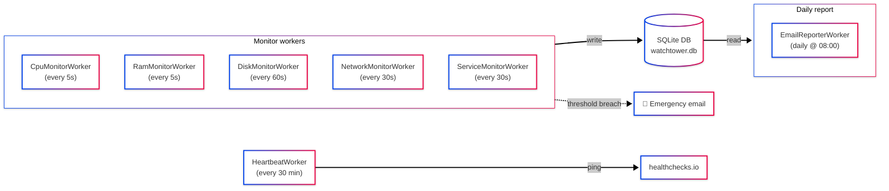

<p align="center">
  
</p>

<h1 align="center">WatchTower</h1>

<p align="center">
  <strong>A lightweight Windows Service that monitors your server's vitals, watches over critical services, and keeps you informed — before things go wrong.</strong>
</p>

<p align="center">
  <a href="#features">Features</a> &bull;
  <a href="#architecture">Architecture</a> &bull;
  <a href="#getting-started">Getting Started</a> &bull;
  <a href="#configuration">Configuration</a> &bull;
  <a href="#deployment">Deployment</a> &bull;
  <a href="#testing">Testing</a>
</p>

<p align="center">
  <a href="https://github.com/angatiabenson/watch-tower/actions/workflows/deploy.yml"></a>
  
  
  
  
  
  
  
</p>

---

## What is WatchTower?

WatchTower is a C# .NET 8 Windows Service built to be your **eyes, ears, and agent** on a Windows Server. It runs silently in the background and:

- **Monitors server vitals** — CPU, RAM, Disk usage, Disk I/O queue, and Network output queue
- **Watches over Windows services** — detects when they stop, auto-restarts them, and alerts you if they can't recover
- **Sends rich HTML email reports** — daily scheduled reports and instant emergency alerts with full context
- **Pings healthchecks.io** — acts as a dead man's switch so you know if WatchTower itself goes down
- **Persists all data to SQLite** — no data loss across service restarts or deployments

Every threshold, interval, and recipient is configurable from a single `appsettings.json` file with hot-reload support — no redeployment needed to tune behavior.

---

## Features

### Real-Time Monitoring

| Metric | Default Poll | Threshold | Behavior |
|--------|-------------|-----------|----------|
| **CPU Usage** | 5s | 99% sustained for 5 min | Emergency email with top 3 CPU processes |
| **RAM Usage** | 5s | 90% sustained for 5 min | Emergency email with top 3 memory processes |
| **Disk Usage** | 60s | 70% warning, 85% critical | Emergency email per drive at critical |
| **Disk Queue Length** | 60s | > 2 per disk | Emergency email — disk can't keep up with I/O |
| **Network Output Queue** | 30s | > 0 per interface | Emergency email — NIC saturated |
| **Windows Services** | 30s | Service stopped | Auto-restart (max 3 attempts), then emergency email |

### Spike Detection

Even if CPU or RAM usage drops back below the threshold before the sustained emergency window (5 minutes), WatchTower still records it as a **spike incident** in the daily report — complete with the exact time and the top 3 processes consuming that resource at the moment of the spike.

### Service Auto-Recovery

When a watched Windows service stops unexpectedly:

1. WatchTower waits the configured delay (default 10s)
2. Attempts a restart
3. Records the restart as an incident (with exact timestamp)
4. If restart fails after 3 consecutive attempts, sends an emergency email
5. Uses display names in reports (e.g., "Windows Update" instead of `wuauserv`)

### Daily Reports

Comprehensive HTML email reports sent daily at a configurable time (default 08:00 EAT). Each report includes:

- **CPU & RAM** — min/avg/max over 24 hours, current RAM in GB
- **Disk Queue & Network Queue** — side-by-side cards with descriptions
- **Disk Usage** — per-drive with visual progress bars
- **Watched Services** — status with colored indicators
- **Incidents** — timestamped log with top process details for CPU/RAM events

All times displayed in **EAT (East Africa Time, UTC+3)**.

### Alerts that operators can trust

Every problem WatchTower detects is an **alert** with a stable key — `cpu`, `ram`,
`disk:C:\`, `diskqueue:<instance>`, `net:<interface>`, `svc:<service>`,
`pool:<app pool>`, `endpoint:<name>` — and a lifecycle that survives restarts (SQLite
table `alert_state`, untouched by the daily report purge):

- **Opened** — the first time the condition is seen, the incident is recorded, sent to the
  portal and a notification goes out.
- **Still open** — nothing new is recorded; a reminder is sent every
  `Alerting:RenotifyMinutes` (default 60, `0` = never). A higher severity (e.g. a
  certificate that was expiring is now expired) escalates and notifies again.
- **Resolved** — when the condition clears, a "resolved" notification says how long it
  lasted (`Alerting:SendRecovery`, default `true`). CPU, RAM, disk, disk-queue and network
  alerts resolve only after staying clear for `Alerting:ResolveAfterSeconds` (default 300),
  so values hovering around a threshold do not flap.
- An alert that was open before a restart is **not** re-sent.

CPU/RAM spike incidents are still recorded (without notifying) for the daily report.

Alert emails are short (title, description, server, times, top processes). Set
`Alerting:IncludeFullReport: true` to attach the full 24-hour server report as before.

### Notification channels

Alerts go to every enabled channel whose `MinSeverity` (`Info` | `Warning` | `Critical`,
default `Info`) the alert meets. Channels are sent in parallel with a short timeout
(`Notifications:TimeoutSeconds`, default 10); a failing channel is logged by name and type
— never its URL — and does not block the others.

Delivery is tracked per channel (SQLite table `alert_delivery`, kept across restarts). A
channel that failed is retried with backoff (1, 2, 4, 8, 16, then every 30 minutes) — the
channels that already have the notification never get it twice. Opened and reminder notices
are retried while their alert stays open; resolved notices and one-shot events for up to 24
hours. An alert only counts as notified (`notifyCount`, `lastNotifiedAt`) once a notice
actually reached a channel.

| Channel | Configure (console: *Notification channels*) | Payload |
|---|---|---|
| Email | `Notifications:Email:Enabled` (default `true`) + the `Email` SMTP settings | Short HTML alert |
| Microsoft Teams | `Notifications:Teams:Url` — a Teams *Workflows* "Post to a channel when a webhook request is received" URL | Adaptive Card |
| Slack | `Notifications:Slack:Url` — an incoming-webhook URL | Block Kit |
| Webhook | `Notifications:Webhook:Url` (+ optional `Secret`) | JSON (`schema: "watchtower.alert.v1"`) |

Text that comes from the monitored server (service and process names, HTTP reason phrases,
descriptions) is never rendered as markup: Teams cards backslash-escape Markdown, and Slack
messages carry it in `plain_text` blocks with the fallback text sent as `"mrkdwn": false`.

Webhook URLs and secrets are stored DPAPI-encrypted and never returned by the console API.
With a secret, every webhook request carries
`X-WatchTower-Signature: sha256=<hex HMAC-SHA256(secret, raw request body)>` and
`X-WatchTower-Event: opened|reminder|resolved|event|test`. Webhook body:

```json
{ "schema": "watchtower.alert.v1", "kind": "opened", "alertKey": "disk:C:\\", "severity": "critical",
  "title": "Disk Critical: C:\\ at 91.0%", "description": "Drive C:\\ at 91.0% (9.7 GB free of 126.5 GB)",
  "server": "SRV-01", "occurredAt": "2026-11-03T08:10:00Z", "openedAt": "2026-11-03T08:10:00Z",
  "durationSeconds": 0, "notifyCount": 1, "incidentType": "DiskCritical" }
```

More channels — several Teams channels, a Slack channel for critical alerts only, a
second webhook — go in the `Notifications:Channels` list. The console has no list editor, so
import them (`WatchTower config import channels.json`); an entry named `email`, `teams`,
`slack` or `webhook` replaces that fixed channel:

```json
{ "Notifications": { "Channels": [
  { "Name": "oncall-slack", "Type": "Slack", "Url": "https://hooks.slack.com/services/...", "MinSeverity": "Critical" },
  { "Name": "itsm", "Type": "Webhook", "Url": "https://itsm.example/hooks/watchtower", "Secret": "...", "Enabled": true }
] } }
```

Test the setup from the console (*Send test notification*, `POST /api/actions/test-notification`)
or from the portal (action `SendTestNotification` = 501, optional parameter `Channel`).

### Maintenance windows

```powershell
WatchTower maintenance start --minutes 90 --reason "Monthly patching"
WatchTower maintenance stop
```

This sets `Maintenance:Until` (UTC) / `Maintenance:Reason` in the operator settings (the
console can do the same, and the portal can push `maintenance: { untilUtc, reason }`, at
most 7 days ahead, which takes precedence). During the window incidents are still recorded
and sent to the portal, but **notifications are held** and **services / application pools
are not restarted automatically** (checked again right before each automatic start, so a
window that opens during the restart delay still prevents it). When the window ends (also
after an agent restart), what was held is delivered: alerts still open notify once, alerts
that had notified before the window send their resolved notice, and everything else —
alerts that opened and cleared inside the window, the patch reboot — arrives as one
"Maintenance ended: N held notifications" summary (alert key `maintenance`).

### Endpoint checks

`Monitoring:Endpoints` checks what the server serves:

| Field | Default | |
|---|---|---|
| `Name` | – | Unique; alert key `endpoint:<Name>` |
| `Type` | `Http` | `Http` (GET), `Tcp` (connect), `Certificate` (TLS handshake, days until expiry) |
| `Target` | – | Http: URL · Tcp: `host:port` · Certificate: `host`, `host:port` (443) or an https URL |
| `TimeoutSeconds` | 10 | 1–120 |
| `ExpectStatus` | `200-399` | Http: e.g. `200`, `200,204,301-302` |
| `ExpectBodyContains` | – | Http: required text (case-sensitive) |
| `CertificateWarnDays` | 21 | Certificate: warn when fewer days are left |
| `IntervalSeconds` | 60 | 5–86400 |
| `FailuresBeforeAlert` | 2 | Consecutive failures before the endpoint is reported down |

An endpoint alerts *Critical* (`EndpointDown`) after `FailuresBeforeAlert` failures (an
invalid or expired certificate counts as a failure), *Warning* (`CertificateExpiring`) as
soon as a certificate is inside its warning window, and resolves (`EndpointRecovered`) when
the check passes. HTTP redirects are followed at most 5 times and only within the same host.
Configure the list with `WatchTower config import endpoints.json` (it is validated first);
the console shows the results read-only:

```json
{ "Monitoring": { "Endpoints": [
  { "Name": "intranet", "Type": "Http", "Target": "https://intranet.example/health", "ExpectBodyContains": "OK" },
  { "Name": "intranet-tls", "Type": "Certificate", "Target": "intranet.example" },
  { "Name": "sql", "Type": "Tcp", "Target": "db01:1433", "IntervalSeconds": 30 }
] } }
```

### Dead Man's Switch

WatchTower pings a healthchecks.io URL every 10 minutes. If the pings stop (because WatchTower crashed, the server is down, or there's a network issue), healthchecks.io alerts you. This ensures you're notified even when the monitoring service itself fails.

The ping is **health-gated**: each monitor worker reports every successful cycle, and when
any of them has had none for 3× its poll interval (at least 2 minutes) WatchTower pings
`<url>/fail` instead, with the stalled workers as the reason — so a hung monitor is noticed
even though the process is still running. After a server restart WatchTower also sends a
one-off "Server restarted at …" notification (Warning; Info if WatchTower had been stopped
cleanly first).

### SQLite Persistence

All metrics are persisted to a local `watchtower.db` SQLite database:

- **Survives service restarts** — no data loss during deployments or Windows updates
- **WAL mode** — safe concurrent reads and writes
- **Automatic purge** — all data cleared after the daily report email is sent successfully
- **Preserved during deployments** — CI/CD pipeline backs up and restores the database

---

## Architecture



**Seven independent `BackgroundService` workers** share a singleton `SqliteMetricsStore`:

| Worker | Responsibility | Poll Interval |
|--------|---------------|---------------|
| `CpuMonitorWorker` | CPU usage + spike detection + sustained emergency | 5s |
| `RamMonitorWorker` | RAM usage + spike detection + sustained emergency | 5s |
| `DiskMonitorWorker` | Disk space + disk queue length monitoring | 60s |
| `NetworkMonitorWorker` | Network output queue monitoring | 30s |
| `ServiceMonitorWorker` | Windows service health + auto-restart | 30s |
| `HeartbeatWorker` | Dead man's switch ping to healthchecks.io | 30min |
| `EmailReporterWorker` | Daily scheduled HTML report + data purge | Daily |

## Getting Started

### Prerequisites

- [.NET 8 SDK](https://dotnet.microsoft.com/download/dotnet/8.0) (or later)
- Windows 10/11 or Windows Server 2016+
- SMTP credentials (Gmail, Outlook, or any SMTP provider)
- *(Optional)* [healthchecks.io](https://healthchecks.io) account for dead man's switch

### Build & Run Locally

```bash
# Clone the repository
git clone https://github.com/angatiabenson/watch-tower.git
cd watch-tower

# Restore dependencies
dotnet restore

# Build
dotnet build

# Run locally (console mode — not as a service)
dotnet run --project src/WatchTower
```

When running locally, WatchTower runs as a console app with live log output. It will start monitoring immediately. Press `Ctrl+C` to stop.

### Install as a Windows Service

```powershell
# Publish a release build
dotnet publish src/WatchTower/WatchTower.csproj -c Release -o C:\Services\WatchTower -r win-x64 --self-contained false

# Create the Windows service
sc.exe create WatchTower binPath="C:\Services\WatchTower\WatchTower.exe" start=auto
sc.exe description WatchTower "WatchTower Server Monitoring Service"

# Start it
Start-Service WatchTower

# Verify it's running
Get-Service WatchTower
```

The service will auto-start on boot (`start=auto`).

---

## Configuration

All configuration lives in `appsettings.json`. Every value supports **hot-reload** — changes take effect on the next poll cycle without restarting the service.

### Full Configuration Reference

```jsonc
{
  // Serilog logging configuration
  "Serilog": {
    "Using": ["Serilog.Sinks.Console", "Serilog.Sinks.File"],
    "MinimumLevel": {
      "Default": "Information",
      "Override": {
        "Microsoft": "Warning",
        "System": "Warning"
      }
    },
    "WriteTo": [
      { "Name": "Console" },
      {
        "Name": "File",
        "Args": {
          "path": "Logs/watchtower-.log",
          "rollingInterval": "Day",
          "retainedFileCountLimit": 30,
          "outputTemplate": "{Timestamp:yyyy-MM-dd HH:mm:ss.fff zzz} [{Level:u3}] {Message:lj}{NewLine}{Exception}"
        }
      }
    ]
  },

  "Monitoring": {
    // CPU monitoring
    "Cpu": {
      "PollIntervalSeconds": 5,       // How often to sample CPU
      "ThresholdPercent": 99.0,        // Emergency threshold
      "SustainedSeconds": 300,         // Must stay above threshold for this long
      "TopProcessCount": 3             // Number of top processes in emergency report
    },

    // RAM monitoring
    "Ram": {
      "PollIntervalSeconds": 5,
      "ThresholdPercent": 90.0,
      "SustainedSeconds": 300,
      "TopProcessCount": 5
    },

    // Disk monitoring
    "Disk": {
      "PollIntervalSeconds": 60,
      "WarningThresholdPercent": 70.0,   // Log warning
      "CriticalThresholdPercent": 85.0,  // Send emergency email
      "QueueLengthWarningThreshold": 2.0 // I/O queue depth per disk
    },

    // Windows service monitoring
    "Services": {
      "PollIntervalSeconds": 30,
      "MaxRestartAttempts": 3,          // Give up after N consecutive failures
      "RestartDelaySeconds": 10,        // Wait before attempting restart
      "WatchedServices": [              // Service names (not display names)
        // "MSSQLSERVER",
        // "W3SVC",
        // "WinRM"
      ]
    },

    // Network monitoring
    "Network": {
      "PollIntervalSeconds": 30,
      "OutputQueueWarningThreshold": 0.0 // Any queue = saturated NIC
    }
  },

  // Dead man's switch
  "Heartbeat": {
    "Url": "https://hc-ping.com/your-uuid-here",
    "IntervalSeconds": 1800             // 30 minutes
  },

  // SMTP email configuration
  "Email": {
    "SmtpHost": "smtp.gmail.com",
    "SmtpPort": 587,
    "Security": "StartTls",            // StartTls | Ssl | None | Auto
    "Username": "your-email@gmail.com",
    "Password": "your-app-password",
    "FromAddress": "your-email@gmail.com",
    "FromName": "WatchTower",
    "ToAddresses": [
      "admin@example.com",
      "oncall@example.com"
    ]
  },

  // Reporting schedule
  "Reporting": {
    "DailyReportTime": "08:00"         // 24hr format, EAT timezone
  },

  // Alert lifecycle (see "Alerts that operators can trust")
  "Alerting": {
    "RenotifyMinutes": 60,             // Reminder interval while an alert stays open (0 = never)
    "SendRecovery": true,              // Notify when an alert resolves
    "IncludeFullReport": false,        // Attach the 24h report to alert emails
    "ResolveAfterSeconds": 300         // Metric alerts resolve after staying clear this long
  },

  // Where alerts go (see "Notification channels")
  "Notifications": {
    "Email":   { "Enabled": true, "MinSeverity": "Info" },
    "Teams":   { "Url": "", "MinSeverity": "Info" },
    "Slack":   { "Url": "", "MinSeverity": "Info" },
    "Webhook": { "Url": "", "Secret": "", "MinSeverity": "Info" },
    "TimeoutSeconds": 10,
    "Channels": []
  },

  // Maintenance window (see "Maintenance windows")
  "Maintenance": { "Until": "", "Reason": "" }
}
```

### Gmail Setup

To use Gmail as your SMTP provider:

1. Enable [2-Step Verification](https://myaccount.google.com/security) on your Google account
2. Generate an [App Password](https://myaccount.google.com/apppasswords)
3. Use the app password (not your account password) in the config:

```json
{
  "Email": {
    "SmtpHost": "smtp.gmail.com",
    "SmtpPort": 587,
    "Security": "StartTls",
    "Username": "your-email@gmail.com",
    "Password": "your-16-char-app-password"
  }
}
```

### Finding Service Names

To find the correct service name for `WatchedServices`, run:

```powershell
# List all services with both names
Get-Service | Select-Object Name, DisplayName, Status | Format-Table -AutoSize

# Search for a specific service
Get-Service | Where-Object DisplayName -like "*SQL*"
```

Use the `Name` column (e.g., `MSSQLSERVER`), not the `DisplayName` (e.g., "SQL Server (MSSQLSERVER)"). WatchTower will resolve and show the display name in reports automatically.

### Determining Thresholds for Your Server

Run these commands on the target server during **peak hours** to understand baseline performance:

**Disk Queue Length:**

```powershell
# Check disk type (SSD vs HDD affects expected queue depth)
Get-PhysicalDisk | Select-Object FriendlyName, MediaType, Size, HealthStatus

# Sample disk queue for 5 minutes
Get-Counter '\PhysicalDisk(*)\Current Disk Queue Length' -SampleInterval 10 -MaxSamples 30 |
  ForEach-Object { $_.CounterSamples } |
  Group-Object InstanceName |
  ForEach-Object {
    $vals = $_.Group.CookedValue
    [PSCustomObject]@{
      Disk = $_.Name
      Min  = ($vals | Measure-Object -Minimum).Minimum
      Avg  = ($vals | Measure-Object -Average).Average
      Max  = ($vals | Measure-Object -Maximum).Maximum
    }
  } | Format-Table
```

- **SSD/NVMe**: threshold of **2** is reasonable (queue should rarely exceed 1)
- **HDD**: raise to **4-5** (queues of 1-3 are normal under load)

**Network Output Queue:**

```powershell
# Check NIC speed
Get-NetAdapter | Where-Object Status -eq 'Up' | Select-Object Name, LinkSpeed

# Sample network queue (should always be 0 on a healthy server)
Get-Counter '\Network Interface(*)\Output Queue Length' -SampleInterval 5 -MaxSamples 12
```

The default threshold of **0** is correct for most servers — any non-zero value means the NIC is saturated.

---

## Incident Types

WatchTower tracks the following incident types in the daily report:

| Type | Trigger | Details Included |
|------|---------|-----------------|
| `CpuSpikeDetected` | CPU exceeds threshold (instant) | Top 3 CPU processes with PID, current CPU percentage, memory |
| `CpuThresholdBreached` | CPU sustained above threshold for N seconds | Top 3 CPU processes + emergency email |
| `RamSpikeDetected` | RAM exceeds threshold (instant) | Top 3 memory processes with PID, current CPU percentage, memory |
| `RamThresholdBreached` | RAM sustained above threshold for N seconds | Top 3 memory processes + emergency email |
| `DiskCritical` | Disk usage exceeds critical threshold | Drive name, usage percentage |
| `DiskQueueHigh` | Disk I/O queue exceeds threshold | Disk instance, queue length |
| `NetworkQueueSaturated` | Network output queue > 0 | Interface name, queue length |
| `ServiceRestarted` | Watched service was stopped and successfully restarted | Service name, display name, timestamp |
| `ServiceDown` | Watched service found stopped | Service name |
| `ServiceRestartFailed` | Service failed to restart after max attempts | Failure count + emergency email |
| `ApplicationPoolDown` / `ApplicationPoolStarted` / `ApplicationPoolStartFailed` | IIS application pool stopped / started again / could not be started | Pool name |
| `EndpointDown` (13) | Endpoint check failed `FailuresBeforeAlert` times in a row (or certificate invalid/expired) | Endpoint, target, reason |
| `EndpointRecovered` (14) | A down or expiring endpoint passes again | Endpoint, result, response time |
| `CertificateExpiring` (15) | TLS certificate inside its warning window | Days left, expiry date |
| `ServerRestarted` (16) | The server rebooted since WatchTower last ran | Boot time, whether the stop was clean |

Incident type numbers are a wire contract (SQLite and portal): append-only.

---

## Deployment

### CI/CD Pipeline

WatchTower uses GitHub Actions with a self-hosted runner for automated deployment. The pipeline triggers on pushes to `main` that modify source code, tests, or the workflow file itself.

**What the pipeline does:**

1. **Version detection** — auto-increments patch version from the latest git tag (e.g., `v1.0.0` -> `v1.0.1`)
2. **Build & Test** — compiles and runs all 77 unit tests
3. **Publish** — creates a Windows x64 deployment package
4. **Backup** — saves the current deployment to `C:\Services\WatchTower.backups\v{version}_{timestamp}`
5. **Deploy** — copies new files, preserves `appsettings.json` and `watchtower.db`
6. **Health check** — verifies the service starts successfully
7. **Auto-rollback** — restores from backup if the service fails to start
8. **Tag & Release** — creates a git tag and GitHub release with the deployment zip

### Versioning

WatchTower uses **semantic versioning** based on git tags:

```bash
# Create the initial version tag
git tag v1.0.0
git push --tags

# Subsequent deployments auto-increment the patch version
# v1.0.0 → v1.0.1 → v1.0.2 → ...
```

To bump minor or major version, create the tag manually:

```bash
git tag v1.1.0  # or v2.0.0
git push --tags
```

### Backup & Rollback

Every deployment creates a versioned backup in `C:\Services\WatchTower.backups\`. The 3 most recent backups are kept.

**Auto-rollback**: If the service fails to start after deployment, the pipeline automatically restores the previous version.

**Manual rollback** via GitHub Actions:

```
Actions → Rollback WatchTower → Run workflow
  Action: "list-backups" (to see available versions)
  Action: "rollback" + Version: "latest" or specific version string
```

### First-Time Server Setup

```powershell
# 1. Install .NET 8 Runtime (if not already installed)
# Download from https://dotnet.microsoft.com/download/dotnet/8.0

# 2. Create the deploy directory
New-Item -ItemType Directory -Path C:\Services\WatchTower -Force

# 3. Configure the self-hosted GitHub runner
# Follow: https://docs.github.com/en/actions/hosting-your-own-runners

# 4. Push to main — the pipeline handles the rest
# Or deploy manually:
dotnet publish src/WatchTower/WatchTower.csproj -c Release -o C:\Services\WatchTower -r win-x64 --self-contained false
sc.exe create WatchTower binPath="C:\Services\WatchTower\WatchTower.exe" start=auto
Start-Service WatchTower
```

---

## Testing

WatchTower has **77 unit tests** covering the workers, services, the SQLite metrics store, the portal outbox/command stores, and remote-config validation. Worker tests are deterministic — they drive a single iteration directly with a `FakeTimeProvider`, so there are no real-time sleeps or scheduling races.

```bash
# Run all tests
dotnet test

# Run with verbose output
dotnet test --verbosity normal

# Run a specific test class
dotnet test --filter "FullyQualifiedName~CpuMonitorWorkerTests"
```

### Test Coverage

| Test Class | Tests | What's Tested |
|-----------|-------|---------------|
| `CpuMonitorWorkerTests` | 4 | Metric storage, below-threshold no-email, spike incident logging, sustained breach emergency |
| `RamMonitorWorkerTests` | 3 | Metric storage, below-threshold no-email, spike incident logging |
| `DiskMonitorWorkerTests` | 4 | Metric storage, critical disk email, below-warning no-email, high queue email |
| `NetworkMonitorWorkerTests` | 3 | Metric storage, zero-queue no-email, above-threshold emergency |
| `ServiceMonitorWorkerTests` | 4 | Running service status, restart attempts, successful restart incident, no-services no-query |
| `HeartbeatWorkerTests` | 2 | Successful ping, failed ping error handling |
| `EmailReporterWorkerTests` | 2 | Daily report sent, data purged after send |
| `MetricsStoreTests` | 8 | In-memory add/get/purge for all metric types |
| `ReportBuilderTests` | 5 | CPU/RAM min/avg/max computation, zero-data handling, HTML rendering, RAM GB fields |
| `SqliteMetricsStoreTests` | 6 | CRUD operations, upsert behavior, incident process serialization, full purge, persistence across reopens |

All tests use **Moq** for dependency mocking and **FluentAssertions** for readable assertions.

---

## Logs

Log files are written to the `Logs/` directory relative to the executable:

```
C:\Services\WatchTower\Logs\watchtower-20260320.log
```

- **Daily rotation** — new file each day
- **30-day retention** — old logs automatically deleted
- **Structured format** — timestamp, level, message, exceptions

```
2026-03-20 14:30:05.123 +03:00 [INF] CPU Monitor Worker started
2026-03-20 14:30:10.456 +03:00 [WRN] CPU spike detected: CPU hit 99.2% (threshold: 99%)
2026-03-20 14:35:10.789 +03:00 [WRN] CPU EMERGENCY: CPU at 99.5% for over 300s
```

---

## Tech Stack

| Component | Technology |
|-----------|-----------|
| Runtime | .NET 8 (`net8.0-windows`) |
| Service hosting | `Microsoft.Extensions.Hosting.WindowsServices` |
| Storage | SQLite via `Microsoft.Data.Sqlite` |
| Email | MailKit (SMTP with StartTLS/SSL) |
| Logging | Serilog (Console + File sinks) |
| Metrics | `System.Diagnostics.PerformanceCounter` |
| Service control | `System.ServiceProcess.ServiceController` |
| HTTP | `IHttpClientFactory` |
| Testing | xUnit + Moq + FluentAssertions |
| CI/CD | GitHub Actions (self-hosted runner) |

---
