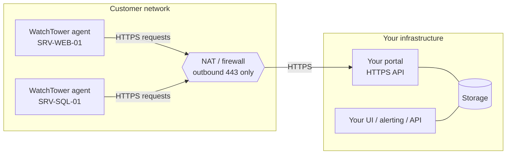
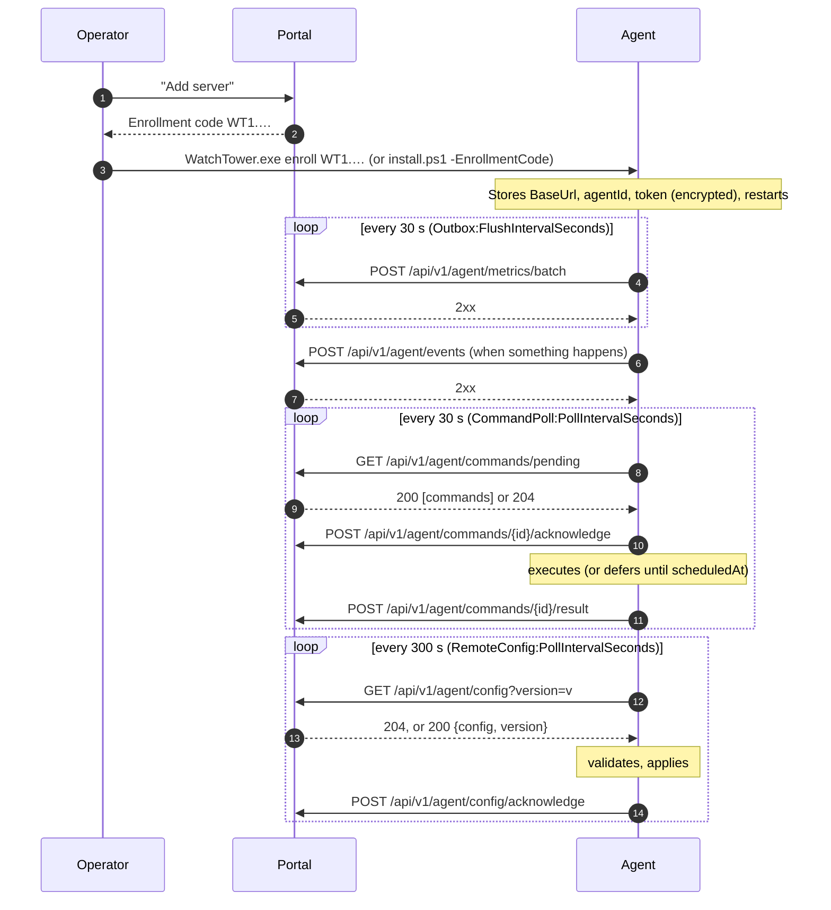

# 01 Concepts

[Portal API guide](README.md) › Concepts

## Architecture: the agent is the client

- **Outbound only.** The agent opens every connection. It never listens for the portal (its local
  web console is a separate thing for operators on the server and is not part of this
  protocol). Agents behind NAT, proxies or firewalls that only allow outbound HTTPS work without
  port forwarding or VPNs.
- **Push for data, poll for control.** Metrics and events are pushed. Commands and configuration
  are pulled on a timer. Your portal can't reach an agent sooner than its next poll (30 s for
  commands and 300 s for configuration by default). To speed up configuration delivery, send a
  ForceConfigSync command. See [Commands](08-commands.md).
- **Store and forward.** Data is written to a local SQLite outbox first and delivered when the
  portal answers 2xx. A portal outage loses nothing that is younger than the retry limits (see
  [Reliability](10-reliability.md)), but data can arrive late, twice and out of order.
- **One portal per agent.** An agent has exactly one `BaseUrl`, one `AgentId` and one token.

## Glossary

| Term | Meaning |
| --- | --- |
| **Agent** | The WatchTower Windows service on one server. Version visible in `agent.version` of every batch. |
| **Portal** | Your server implementing the seven endpoints. The agent's settings call it the "Visibility Portal" (`VisibilityPortal:*`). |
| **BaseUrl** | The portal address configured on the agent (`VisibilityPortal:BaseUrl`), for example `https://portal.example.com` or `https://example.com/watchtower`. The agent appends `/api/v1/agent/...`. |
| **agentId** | The agent's identity, chosen by the portal (or the operator) and configured on the agent (`VisibilityPortal:AgentId`). Sent in the `X-Agent-Id` header and in every metrics batch. |
| **Token** | A secret issued by the portal for one agent (`VisibilityPortal:AgentToken`). Sent as `Authorization: Bearer <token>`. Stored encrypted (DPAPI) on the agent. |
| **Batch** | One `POST metrics/batch` body: new CPU and RAM samples plus the latest snapshot of everything else, with a `batchId`. |
| **Event** | One `POST events` body: an incident (threshold breach, service down, reboot...) with an `eventId`, optionally tied to an alert. |
| **Alert** | A condition with a lifecycle, identified by an `alertKey` such as `cpu` or `svc:W3SVC`. Events with `resolved: false` open or escalate it, and `resolved: true` closes it. |
| **Outbox** | The agent's local queue of batches and events waiting for delivery. |
| **Command** | A request from the portal to do something (restart a service, update the agent, ...), identified by a `commandId`. |
| **Action type** | The number that says what a command does (101 = ServiceStart ... 501 = SendTestNotification). See [Commands](08-commands.md). |
| **Remote config** | A versioned JSON object from the portal that overrides some of the agent's settings. See [Remote configuration](09-remote-config.md). |
| **Enrollment code** | `WT1.` + base64url JSON with the portal URL, agentId, token and TLS flag. Pasted into the agent to connect it in one step. See [Authentication and enrollment](03-authentication-and-enrollment.md). |
| **Seed file** | A JSON settings file applied at install time (`install.ps1 -ConfigFile`), for unattended rollouts. It can carry the portal settings instead of an enrollment code. |
| **Maintenance window** | A period in which the agent holds notifications and automatic restarts, set by the operator or by the portal. It is reported in `agent.maintenance`. |

## Responsibilities

| The agent guarantees | The portal MUST |
| --- | --- |
| Sends the credentials on every request. | Authenticate `X-Agent-Id` + bearer token on every request and derive the identity from them, never from body fields. |
| Keeps a `batchId` / `eventId` stable across retries of the same message. | Deduplicate on `batchId` and `eventId` and answer 2xx to duplicates. |
| Delivers batches and events at least once while within retry limits. | Accept late data (old timestamps) and out-of-order data. |
| Omits nulls and only adds optional fields within v1. | Ignore unknown JSON properties and unknown enum values. |
| Never executes a `commandId` twice (it remembers IDs for a year by default) and refuses stale ones. | Give every command a globally unique, never reused `commandId` and a current `issuedAt`, and expire commands the agent never acknowledged. |
| Only touches services and application pools the operator allowed locally. | Not rely on a command succeeding; show the reported result. |
| Retries command results (with backoff, for up to 7 days) and config acknowledgements until 2xx. | Answer 2xx to repeated results and acknowledgements, even for IDs it no longer knows. |
| Validates every remote configuration and applies all or nothing. | Track which version each agent acknowledged, and which version it reports in `GET config?version=`. A missing acknowledgement is not proof that a version was not applied: a newer applied version supersedes an older unacknowledged one. |
| Uses HTTPS and validates the certificate, unless the operator opted into plain HTTP. | Serve a certificate the agent's Windows trusts; never redirect agent API calls. |

## Overall flow

The three loops are independent and run in parallel: a slow command doesn't delay metrics, and a
failing metrics endpoint doesn't stop command polling.

## What the portal does not get

- **No inbound calls, no push channel.** There are no WebSockets or callbacks. Everything goes
  through the polls.
- **No historic backfill on request.** The agent sends each CPU/RAM sample once (at least once,
  more on retry). It keeps its own history for its console, but there is no API to fetch it.
- **No log shipping.** Agent logs stay on the server ([Troubleshooting](13-troubleshooting-faq.md)
  says where).
- **No arbitrary command execution.** The action catalog is fixed; see [Commands](08-commands.md).

Next: [Quickstart](02-quickstart.md).
