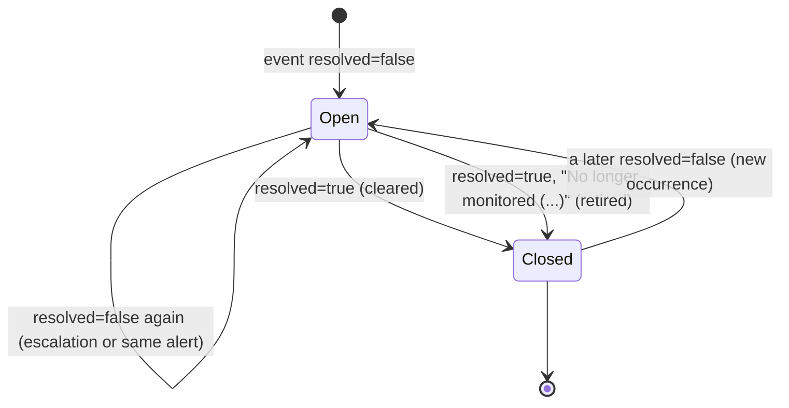

# 07 Events and alerts

[Portal API guide](README.md) › Events and alerts

The agent evaluates every condition locally, sends its own notifications (email, Teams, Slack,
webhooks) and reports every incident to the portal as an [event](05-endpoints/events.md). Events
come in three shapes:

| Shape | `alertKey` | `resolved` | Example |
| --- | --- | --- | --- |
| Alert transition | present | `false` (opened or escalated) or `true` (closed) | `cpu`, `resolved: false` |
| One-shot alert event | present | absent | `reboot` (ServerRestarted) |
| Plain incident | absent | absent | CpuSpikeDetected, ServiceDown; everything from 1.0.x agents |

## Incident types

Numbers never change. New types are only appended (the portal MUST accept unknown numbers and
show them generically). The severity is what the agent itself uses. It is not on the wire, so a
portal SHOULD map types to its own severities and can use this table.

| # | Name | Agent severity | Shape and alert key | When |
| --- | --- | --- | --- | --- |
| 0 | CpuThresholdBreached | Critical | opens `cpu` | CPU ≥ `Monitoring:Cpu:ThresholdPercent` (99) for `SustainedSeconds` (300). Carries `topProcesses` (by CPU). Also the type of the `cpu` close event. |
| 1 | CpuSpikeDetected | Warning | plain | First sample at or above the CPU threshold. Carries `topProcesses`. |
| 2 | RamThresholdBreached | Critical | opens `ram` | RAM ≥ `Monitoring:Ram:ThresholdPercent` (90) for `SustainedSeconds` (300). `topProcesses` by working set. Also the `ram` close type. |
| 3 | RamSpikeDetected | Warning | plain | First sample at or above the RAM threshold. `topProcesses` (3, by working set). |
| 4 | DiskCritical | Critical | opens `disk:<drive>` e.g. `disk:C:\` | Usage ≥ `CriticalThresholdPercent` (85). Closes once usage has stayed below it for the debounce time. `WarningThresholdPercent` (70) only affects the agent's local log and reports. Also the close type. |
| 5 | DiskQueueHigh | Warning | opens `diskqueue:<instance>` | Queue length > `QueueLengthWarningThreshold` (2). Also the close type. |
| 6 | NetworkQueueSaturated | Warning | opens `net:<interface>` | Output queue > `OutputQueueWarningThreshold` (0). Also the close type. |
| 7 | ServiceDown | Critical | plain | A watched service is found stopped (once per outage). The agent then tries to restart it. |
| 8 | ServiceRestarted | Info | closes `svc:<name>` if open, else plain | The agent restarted the service. |
| 9 | ServiceRestartFailed | Critical | opens `svc:<name>` | `MaxRestartAttempts` (3) restarts failed. |
| 10 | ApplicationPoolDown | Critical | plain | A watched pool is found stopped. The agent then tries to start it. |
| 11 | ApplicationPoolStarted | Info | closes `pool:<name>` if open, else plain | The agent started the pool. |
| 12 | ApplicationPoolStartFailed | Critical | opens `pool:<name>` | `MaxStartAttempts` (3) starts failed. |
| 13 | EndpointDown | Critical | opens or escalates `endpoint:<name>` | `FailuresBeforeAlert` (2) consecutive failed checks (an expired or invalid certificate counts as a failed check). |
| 14 | EndpointRecovered | Info | closes `endpoint:<name>` | The check succeeds again (or went from Down to Expiring, see below). |
| 15 | CertificateExpiring | Warning | opens `endpoint:<name>` | The certificate is inside `CertificateWarnDays` (21). |
| 16 | ServerRestarted | Info (clean shutdown) or Warning (unexpected) | one-shot `reboot` | The agent noticed the machine booted since it last ran. |

Types 13 to 16 and all alert keys are after-1.0.19 (unreleased). The `description` is English
text written by the agent; show it, don't parse it.

## Alert lifecycle



An alert is identified by `(agent, alertKey)`. Compare keys **case-insensitively**; the part after
the prefix is the resource name as Windows or the operator wrote it.

| Key | Resource |
| --- | --- |
| `cpu`, `ram` | the machine |
| `disk:<drive>` | a fixed drive, e.g. `disk:C:\` |
| `diskqueue:<instance>` | a physical disk, e.g. `diskqueue:0 C:` |
| `net:<interface>` | a network interface |
| `svc:<serviceName>` | a watched service |
| `pool:<applicationPoolName>` | a watched IIS pool |
| `endpoint:<name>` | an endpoint check |
| `reboot` | one-shot server restart |

Rules a portal SHOULD follow:

1. **Open**: on `resolved: false` for a key without an open alert, open one (opened at
   `timestamp`).
2. **Update or escalate**: on `resolved: false` for an open key, keep it open and update type and
   description, but only if the event is not older than the alert's last transition (the
   `timestamp` of the opening or escalation that set them). An older one is history: keep it,
   but it MUST NOT overwrite a newer severity or description. The agent sends this when an alert
   escalates in severity (an endpoint going from Expiring, type 15, to Down, type 13). The same
   key can also carry a different type later in its life.
3. **Close**: on `resolved: true`, close the open alert if its last transition is older than this
   `timestamp`. The close event's `incidentType` is the recovery type where one exists (8, 11,
   14), otherwise the type that opened the alert.
4. **Out of order**: an event in retry backoff can be overtaken by later ones. Remember when each
   key last closed. A `resolved: false` older than the last close is history and MUST NOT reopen
   the alert. A `resolved: true` without an open alert is recorded, and closes nothing.
5. **Same timestamp**: a close and an opening for the same key with the SAME `timestamp` mean
   "closed, then opened again", whichever arrives first. The agent emits such a pair when a
   resource changes from one problem to another (see Endpoint Down → Expiring below), so the
   alert ends up open with the opening's type. Do not drop the opening because a close with an
   equal timestamp was already recorded.
6. **Duplicates** are filtered by `eventId` before any of this.

Timestamps cannot resolve every reordering: two transitions in the same instant carry no order
between them, and an event the agent dropped (older than `Outbox:EventMaxAgeHours`) never
arrives. Reconcile open alerts against the snapshots in the metrics batches (`endpointStatuses`,
`serviceStatuses`, `applicationPoolStatuses`, `diskMetrics` ...): for example, an open endpoint
alert whose endpoint reports `Up` in a newer snapshot is stale. The reference portal
(`samples/MinimalPortal`) implements rules 1 to 6.

Agent-side behaviour behind these events:

- **Debounce**: CPU, RAM, disk, disk-queue and network alerts close only after the condition has
  been clear for `Alerting:ResolveAfterSeconds` (default 300 s), so a value hovering around a
  threshold doesn't flap. Service, pool and endpoint alerts close as soon as the resource is
  healthy.
- **Endpoint Down → Expiring**: the agent first closes the critical alert (type 14,
  `resolved: true`), then opens a warning on the same key (type 15, `resolved: false`). Both
  events carry the same `timestamp` and may arrive in either order (rule 5).
- **Reminders**: while an alert stays open the agent re-notifies its own channels every
  `Alerting:RenotifyMinutes` (60). Reminders are **not** sent to the portal. One open event per
  occurrence.
- **Occurrences**: each time a key opens again after it closed is a new occurrence with its own
  opening and its own recovery event. The agent queues them for the portal as they happen
  (Opened A → Resolved A → Opened B); a re-opening never cancels the previous occurrence's
  recovery. Like every event they may still arrive out of order after a delivery failure (rule 4).
- **Flapping notices are not portal events**: when more than 5 notices of one key are waiting
  for the agent's own notification channels (email, Teams, webhooks ...), the agent folds the
  middle ones into one resolved notice titled `Flapping: N occurrences between T1 and T2`. That
  folding only happens in the channel delivery queue. The portal still receives every
  occurrence's own `resolved: false` and `resolved: true` events, and never an event with that
  title, so it needs no special handling.
- **Plain incidents**: spikes and "found down" incidents are informational. The alert, if any,
  comes separately (a ServiceDown is followed by ServiceRestarted as a plain incident when the
  restart worked, or by ServiceRestartFailed opening `svc:<name>` when it didn't).

### Retirement

When a resource stops being monitored while its alert is open (a service or pool removed from the
watch list, an endpoint check deleted or left invalid, a drive, physical disk or NIC that disappeared), the agent
**retires** the alert: it sends `resolved: true` with the opening `incidentType` and a description
starting with `No longer monitored (` followed by the reason (for example
`removed from Monitoring:Services:WatchedServices` or `Disk D: is no longer present`):

<!-- schema: AgentEvent -->
```json
{
  "eventId": "4a6c8e0f-2b4d-4f6a-9c8e-0b2d4f6a8c77",
  "timestamp": "2026-11-03T12:05:00.0000000Z",
  "incidentType": 9,
  "description": "No longer monitored (removed from Monitoring:Services:WatchedServices); closed after 2 h 5 min. Last state: Service 'Spooler' failed to restart after 3 attempts",
  "alertKey": "svc:Spooler",
  "resolved": true
}
```

A portal MAY show retired alerts differently from resolved ones (match the prefix), but MUST
close them in either case.

### A full example: a service outage

<!-- schema: AgentEvent -->
```json
{
  "eventId": "5f2d8b3a-7c1e-4a9f-b6d0-3e8a1c5f7b66",
  "timestamp": "2026-11-03T11:00:30.0000000Z",
  "incidentType": 7,
  "description": "Service 'World Wide Web Publishing Service' (W3SVC) is Stopped"
}
```

<!-- schema: AgentEvent -->
```json
{
  "eventId": "3c5e7a9b-1d3f-4b5d-8f0a-2c4e6a8b0d88",
  "timestamp": "2026-11-03T11:01:40.0000000Z",
  "incidentType": 9,
  "description": "Service 'W3SVC' failed to restart after 3 attempts",
  "alertKey": "svc:W3SVC",
  "resolved": false
}
```

<!-- schema: AgentEvent -->
```json
{
  "eventId": "9a3e5c71-2d4b-4f6a-8e1c-7b0d3f5a9c44",
  "timestamp": "2026-11-03T11:02:00.0000000Z",
  "incidentType": 8,
  "description": "Service 'World Wide Web Publishing Service' (W3SVC) was found stopped and restarted successfully",
  "alertKey": "svc:W3SVC",
  "resolved": true
}
```

## Maintenance windows

A maintenance window is set locally (`WatchTower.exe maintenance start`, the console) or by the
portal ([remote config](09-remote-config.md#maintenance-windows) `maintenance`, which takes
precedence over the local one). While it is active, the agent:

- **holds its own notifications** (email, chat, webhooks) and sends one summary when the window
  ends;
- **does not restart** stopped services or start stopped pools by itself;
- **still monitors, records and sends everything to the portal**: batches, events, alert
  transitions, command results. Portal commands still run.

The state is in every batch as `agent.maintenance` (`active`, `untilUtc`, `reason`). A portal
SHOULD suppress its own paging for events whose `timestamp` falls inside an active window of that
agent, and SHOULD show the window. The maintenance summary itself is a local notification only.
No event is sent for it.

## Deduplication summary

| Situation | Key | Portal action |
| --- | --- | --- |
| Same event delivered twice | `eventId` | store once, 2xx |
| Alert reported open again while open | `alertKey` | update, don't open a second |
| Close before open | `alertKey` + timestamps | record close time; ignore older opens |
| Same text, different occurrence | `eventId` differs | new event (and new alert if closed) |
