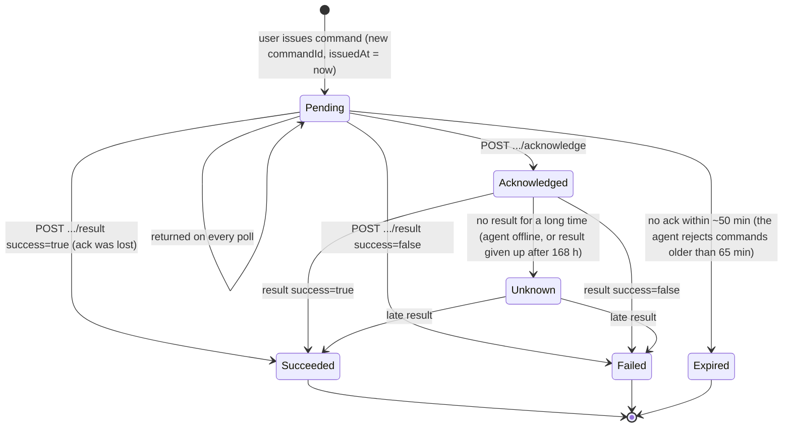
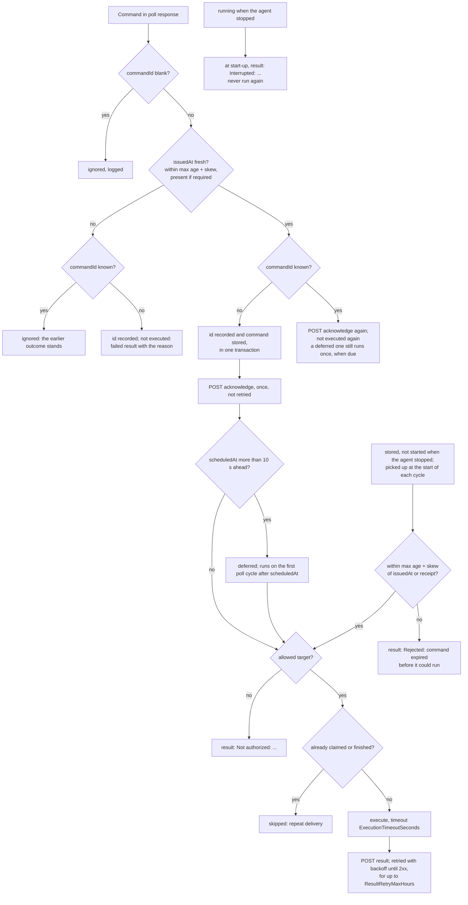

# 08 Commands

[Portal API guide](README.md) › Commands

A command asks one agent to do one thing from a fixed catalog. The portal queues it, the agent
picks it up on its next poll (default every 30 s), acknowledges it, runs it (now or at
`scheduledAt`) and reports the result. Wire details:
[commands/pending](05-endpoints/commands-pending.md),
[acknowledge](05-endpoints/command-acknowledge.md), [result](05-endpoints/command-result.md).

## Lifecycle

As the portal SHOULD track it:



As the agent handles it (each command independently, in the order received):



Details that matter to a portal:

- **Freshness** (replay protection): when `issuedAt` is present it must be parseable, at most
  `CommandPoll:ClockSkewSeconds` (300) in the future and at most `MaxCommandAgeSeconds` (3600) +
  `ClockSkewSeconds` old **when the agent receives it** (exactly 3900 s old or exactly 300 s ahead
  is accepted). Otherwise the command is rejected: never acknowledged or executed, stored as
  failed, and reported with `success: false` and one of these messages, retried like every
  result (see below):
  - `Rejected: command is stale: issuedAt <t> is more than 3900s old (max age 3600s + 300s clock skew; agent time <now>)`
  - `Rejected: issuedAt <t> is more than 300s in the future (agent time <now>)`
  - `Rejected: unparseable issuedAt '<value>'`
  - `Rejected: issuedAt is required` (no `issuedAt` while the operator set
    `VisibilityPortal:RequireCommandIssuedAt = true`; this applies even when
    `MaxCommandAgeSeconds = 0`)

  If the agent already knows the `commandId`, a rejected re-delivery reports nothing (the earlier
  outcome stands). By default (`RequireCommandIssuedAt = false`) a command without `issuedAt` is
  accepted, acknowledged and executed; the agent logs once per process (and after a BaseUrl
  change) `Portal sends commands without issuedAt; replay protection is reduced. Update the
  portal.` Portals SHOULD always send it (REQUIRED in v2), and MUST send it to agents whose
  operators require it. Operators can set `MaxCommandAgeSeconds = 0` to disable the age check.
  Don't count on that.
- **Replay protection by ID**: every `commandId` the agent receives (executed, failed, rejected
  or not authorized) is recorded before anything runs, in the same transaction that stores or
  rejects the command. A known ID is never stored or executed again, even after
  `CommandPoll:RetentionDays` (30 days after a command finished) purged the command and its
  result. A repeat that passes the freshness check is acknowledged again. IDs are remembered for
  `VisibilityPortal:CommandIdRetentionDays` (365 days; 0 = no age limit), at most
  `VisibilityPortal:CommandIdMaxCount` (200 000; 0 = no limit; the oldest are forgotten first),
  pruned hourly, and never while the command itself is still stored. A `commandId` MUST be
  globally unique and never reused.
- **Scheduling**: `scheduledAt` more than 10 s in the future defers the command. It runs on the
  first poll cycle at or after that time (so up to one poll interval late), and only if the agent
  is running then. Freshness is checked at receipt, so a command can be scheduled days ahead as
  long as it is delivered within the hour after `issuedAt`.
- **Execution**: commands run one at a time inside the poll loop. A long command (up to
  `ExecutionTimeoutSeconds`, default 120 s) delays the next poll. On timeout the result is
  `Command timed out after 120s`, but the underlying Windows operation may still complete.
- **After an agent restart** (crash, kill, reboot, update) the agent settles what it had stored:
  - a command that was **running** is never run again (it may have had effects) and is reported
    at start-up as failed: `Interrupted: the agent stopped while this command was running; its
    outcome is unknown`;
  - a command stored but **not started** (no `scheduledAt`) is picked up at the start of every
    poll cycle. Within the age limit (`MaxCommandAgeSeconds` + `ClockSkewSeconds` from
    `issuedAt`, or from when the agent received it if `issuedAt` was absent; no limit when
    `MaxCommandAgeSeconds = 0`) it goes through the normal path: freshness, claim, execution,
    result. Older, it is failed with `Rejected: command expired before it could run (agent
    restarted)`, reported and retried like every rejection, usually after an acknowledgement;
  - a deferred command runs when due.

  Expect results, including these, to arrive long after you sent a command.
- **Results** are stored (surviving restarts) and retried until the portal answers 2xx, each on
  its own backoff: 1, 2, 4, 8 and 16 minutes after the 1st to 5th failed attempt, then every 30
  minutes, at most 50 due results per poll cycle, the longest-due first. A result not accepted
  within `VisibilityPortal:CommandPoll:ResultRetryMaxHours` (168 h) of being produced is given up
  on (`Gave up delivering the result of command <id>: ...` in the agent log). At most 1000
  rejected commands are kept; the oldest are deleted, delivered or not. In both cases the ID
  stays known, so the command never runs later. Details:
  [result](05-endpoints/command-result.md).
- **Maintenance windows don't block commands.** A portal that wants that MUST check
  `agent.maintenance.active` before issuing.
- Commands run with the rights of the agent's service account (LocalSystem by default).

## The local allow-list (AllowPortalManagedTargets)

Service actions (101 to 103) and application-pool actions (201 to 204) only work on names the
operator chose to watch **locally**:

- The allow-list is `Monitoring:Services:WatchedServices` (or `Monitoring:ApplicationPools:WatchedApplicationPools`)
  from the agent's shipped defaults, the operator's settings and environment variables, **never**
  from the portal's remote configuration. A portal can't first push `watchedServices: ["WinDefend"]`
  and then stop Defender.
- Only when the operator sets `VisibilityPortal:CommandPoll:AllowPortalManagedTargets = true` does
  the effective list (including portal-pushed names) count.
- Names are matched case-insensitively after trimming.
- The agent's own service (`WatchTower` by default) is never a valid target of 101 to 103: use
  AgentRestart (303).

Refusals are reported as failed results:

| Situation | `message` |
| --- | --- |
| name not on the allow-list | `Not authorized: 'WinDefend' is not a locally watched service` (or `... application pool`) |
| name parameter missing or blank | `Not authorized: missing ServiceName` (or `AppPoolName`) |
| the agent's own service | `Not authorized: WatchTower does not stop or restart its own service through service commands; use AgentRestart` |

A portal SHOULD offer service and pool actions only for the names it sees in that agent's
`serviceStatuses` / `applicationPoolStatuses`. Those come from the effective watch list, so even
then a refusal is possible when your remote configuration added the name.

## Action catalog

All parameter values are JSON strings. Parameter names are case-sensitive. Unknown parameters are
ignored. Messages are shown exactly as the agent writes them (`<name>` is the trimmed parameter).

| # | Name | Parameters | Gated | Since |
| --- | --- | --- | --- | --- |
| 101 | ServiceStart | `ServiceName` (required), `TimeoutSeconds` | allow-list | base |
| 102 | ServiceStop | `ServiceName` (required), `TimeoutSeconds` | allow-list | base |
| 103 | ServiceRestart | `ServiceName` (required), `TimeoutSeconds` | allow-list | base |
| 201 | AppPoolStart | `AppPoolName` (required), `TimeoutSeconds` | allow-list | base |
| 202 | AppPoolStop | `AppPoolName` (required), `TimeoutSeconds` | allow-list | base |
| 203 | AppPoolRestart | `AppPoolName` (required), `TimeoutSeconds` | allow-list | base |
| 204 | AppPoolRecycle | `AppPoolName` (required) | allow-list | base |
| 301 | ForceMetricSnapshot | none | | base |
| 302 | ForceConfigSync | none | | base |
| 303 | AgentRestart | none | | base (a stub answering "reserved and not yet implemented" up to 1.0.19; working after-1.0.19) |
| 304 | AgentUpdate | `Version` | | after-1.0.19 |
| 401 | ApplyConfiguration | `ConfigJson` (required), `Version` | config validation | base |
| 501 | SendTestNotification | `Channel` | | after-1.0.19 |

Any other number: failed result `Unknown action type: <n>`.

### 101 ServiceStart, 102 ServiceStop, 103 ServiceRestart

- `ServiceName`: the service **key** name (e.g. `W3SVC`, not "World Wide Web Publishing
  Service"). It MUST match `^[A-Za-z0-9_\-\. ]{1,260}$`, otherwise
  `Missing or invalid ServiceName parameter`.
- `TimeoutSeconds`: `"1"` to `"600"`, how long to wait for the service to reach the target state.
  Missing or invalid: 30.

<!-- schema: AgentCommand -->
```json
{ "commandId": "6f1c9a52-6a43-4f3c-9d55-0d9c2b7f4e10", "actionType": 103, "parameters": { "ServiceName": "W3SVC", "TimeoutSeconds": "60" }, "issuedAt": "2026-11-03T10:40:00Z" }
```

| Action | Success messages | Failure message |
| --- | --- | --- |
| 101 | `Service '<name>' is already running` (no-op), `Service '<name>' started successfully` | `Failed to start service '<name>'` |
| 102 | `Service '<name>' stopped successfully` | `Failed to stop service '<name>'` |
| 103 | `Service '<name>' restarted successfully` | `Failed to restart service '<name>'` |

The new state shows up in the next batches (`serviceStatuses`).

**ServiceStop is undone by the agent's own monitor.** Only watched services can be targeted, and
the agent restarts every watched service it finds stopped. After a successful 102, the next
service-monitor cycle (default 30 s) reports ServiceDown and starts the service again. The
exceptions are a service whose start type is Disabled and an active maintenance window, during
which automatic restarts are held. To keep a service stopped, push a maintenance window (or have
the operator remove it from the local watch list), then send 102.

### 201 AppPoolStart, 202 AppPoolStop, 203 AppPoolRestart, 204 AppPoolRecycle

- `AppPoolName`: same pattern as `ServiceName`, otherwise `Missing or invalid AppPoolName parameter`.
- `TimeoutSeconds`: `"1"` to `"600"`, default 30 (ignored by 204, which always waits up to 30 s).
- 203 stops the pool (ignoring the outcome), then starts it.

<!-- schema: AgentCommand -->
```json
{ "commandId": "c4a8e6f2-1b3d-4e5f-8a7c-9d0b2e4f6a32", "actionType": 204, "parameters": { "AppPoolName": "ShopPool" }, "scheduledAt": "2026-11-03T23:00:00Z", "issuedAt": "2026-11-03T10:41:00Z" }
```

Messages: `App pool '<name>' started|stopped|restarted|recycled successfully`, or
`Failed to start|stop|restart|recycle app pool '<name>'`. As with services, a pool stopped by 202
is started again by the agent's pool monitor on its next cycle unless a maintenance window is
active.

### 301 ForceMetricSnapshot

Wakes the outbox worker: it collects and sends a batch right away instead of at the end of the
flush interval. Result `Metric snapshot triggered`. The result and the batch come from two
independent loops: there is no ordering guarantee between them (the batch may arrive before or
after the result, and a failed delivery delays either one).

### 302 ForceConfigSync

Wakes the remote-config worker: `GET config` happens right away. Result `Config sync triggered`.
If the operator disabled remote configuration (`RemoteConfig:Enabled = false`), nothing is fetched,
but the result still says success.

### 303 AgentRestart

Restarts the WatchTower service through a helper process that waits about 2 s. The result is
reported before the restart. Queued data, pending results and stored commands survive. Watch
`agent.startedAt` change in the next batch.

| `success` | `message` |
| --- | --- |
| true | `WatchTower is restarting; the console will be back in a few seconds.` |
| true | `A restart is already in progress.` |
| false | `WatchTower is running interactively (not as a Windows service); restart it manually.` |
| false | `Could not restart: <error>` |

### 304 AgentUpdate

Asks the agent's self-updater to install the newest release its update feed offers
(`Updates:FeedUrl`, channel `Updates:Channel`). The portal can't choose an arbitrary version.
`Version` (optional, a leading `v` is ignored, compared case-insensitively) is a guard: the
command fails unless the feed offers exactly that version.

Flow: check the feed → download → verify (SHA-256 and, when the operator configured
`Updates:PublicKey`, the package signature) → **restart countdown** (`Updates:RestartCountdownSeconds`,
default 30 s, visible and cancellable in the agent's console) → install → service restart → health
check, with automatic rollback if the new version doesn't come up healthy. The result is reported
when the download starts. Follow the rest in the batches: `agent.updatePhase`
(`Downloading` → `ReadyToInstall` → `Installing`), then a new `agent.version`, `agent.startedAt` and
`agent.lastUpdateResult`.

<!-- schema: AgentCommand -->
```json
{ "commandId": "b9d1f3a5-7c9e-4b1d-8f3a-5c7e9b1d3f65", "actionType": 304, "parameters": { "Version": "1.7.0" }, "issuedAt": "2026-11-03T12:00:00Z" }
```

| `success` | `message` |
| --- | --- |
| true | `Already up to date (<current>).` |
| false | the feed error, when the check failed |
| false | `Requested version <Version> is not the version offered by the feed (<offered>).` |
| true | `Installing <offered> after the restart countdown.` (already downloaded) |
| true | `Downloading <offered>; it installs automatically after the restart countdown.` |
| false | `A check or download is already in progress.`, `An installation is already in progress.`, or another updater message |

### 401 ApplyConfiguration

Pushes a remote configuration through the command channel instead of `GET config`.

- `ConfigJson` (required): a **string** containing a JSON [remote configuration](09-remote-config.md)
  object, camelCase and case-sensitive like `GET config`.
- `Version` (optional): the version label to record; default a random UUID.

<!-- schema: AgentCommand -->
```json
{ "commandId": "e3f5a7c9-1b3d-4f5a-9c1e-3a5c7e9b1d76", "actionType": 401, "parameters": { "ConfigJson": "{\"cpu\":{\"thresholdPercent\":90}}", "Version": "2026-11-03.7" }, "issuedAt": "2026-11-03T12:10:00Z" }
```

| `success` | `message` |
| --- | --- |
| true | `Configuration applied (version <Version>)` |
| false | `Missing ConfigJson parameter`, `Invalid ConfigJson: <parser error>`, `ConfigJson deserialised to null` |
| false | the first validation error, e.g. `Cpu.ThresholdPercent must be between 1 and 100` |

The applied version is then acknowledged through
[config/acknowledge](05-endpoints/config-acknowledge.md) on the next config-poll cycle, and is
sent as `GET config?version=<Version>` from then on. If your config endpoint has a different
current version, the next poll replaces it. Use one mechanism consistently. The RECOMMENDED one is
`GET config`, plus ForceConfigSync (302) when the change is urgent.

### 501 SendTestNotification

Sends a test message through the agent's own notification channels (email, Teams, Slack,
webhooks), or only through the channel named by `Channel` (case-insensitive). Severity filters and
maintenance windows don't apply. The result lists each channel's outcome, never its URL or
credentials, for example `Ops mail (Email): ok; Teams (Teams): HTTP 403`. `success` is true only
when every channel succeeded. With no matching channel: `No notification channel is enabled` or
`No enabled notification channel is named '<Channel>'`.

## Portal checklist for commands

- Generate a new UUID `commandId` per command; never reuse one, not even to retry. The agent
  remembers IDs for a year by default and silently skips a known one.
- Set `issuedAt` to the current UTC time when the agent can first receive the command. For
  commands held back by your own workflow (approvals), set it when releasing them.
- Return every unacknowledged command on every poll; stop after the acknowledgement.
- Expire unacknowledged commands after about 50 minutes, before the agent would refuse them as
  stale.
- Record the first result; answer 2xx to all results and acknowledgements.
- Authorize users per agent and action in the portal, and audit-log issuer, command and result.
- Offer service and pool actions only for names the agent reports.
