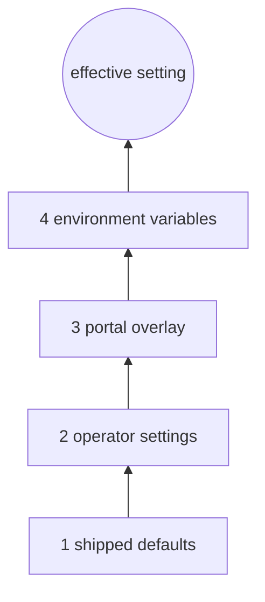
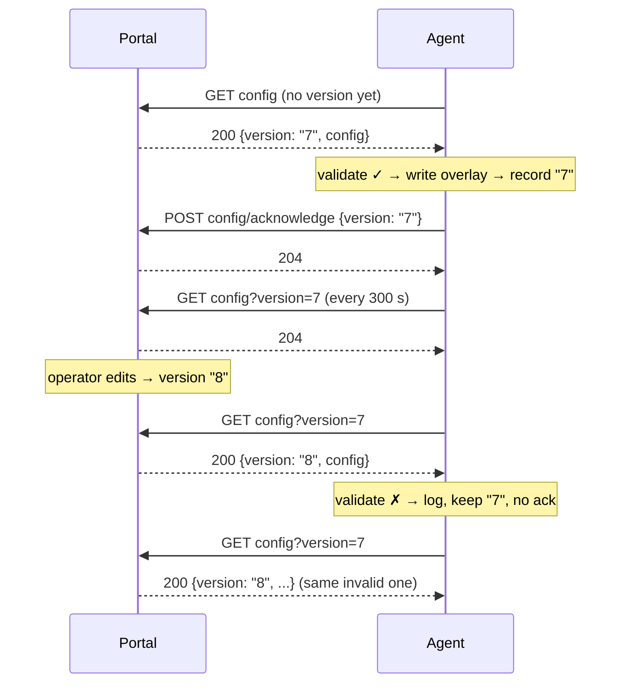

# 09 Remote configuration

[Portal API guide](README.md) › Remote configuration

A portal can override a limited set of the agent's settings: thresholds, alert waiting periods,
poll intervals, the watched services and pools, the agent's portal timings and a maintenance
window. It publishes a **versioned** JSON object per agent. The agent fetches it with
[`GET config`](05-endpoints/config.md), validates it, applies it as a whole and
[acknowledges](05-endpoints/config-acknowledge.md) the version.

## Format

<!-- schema: RemoteAgentConfig -->
```json
{
  "cpu": { "pollIntervalSeconds": 5, "thresholdPercent": 95, "sustainedSeconds": 300 },
  "ram": { "pollIntervalSeconds": 5, "thresholdPercent": 90, "sustainedSeconds": 300 },
  "disk": { "pollIntervalSeconds": 60, "warningThresholdPercent": 75, "criticalThresholdPercent": 90, "queueLengthWarningThreshold": 2,
            "sustainedSeconds": 600, "queueSustainedSeconds": 300 },
  "network": { "pollIntervalSeconds": 30, "outputQueueWarningThreshold": 5, "sustainedSeconds": 300 },
  "services": { "pollIntervalSeconds": 30, "watchedServices": ["W3SVC", "MSSQLSERVER"], "sustainedSeconds": 120 },
  "appPools": { "pollIntervalSeconds": 30, "watchedApplicationPools": ["DefaultAppPool"], "sustainedSeconds": 120 },
  "endpoints": { "sustainedSeconds": 120 },
  "portal": { "outboxFlushIntervalSeconds": 30, "commandPollIntervalSeconds": 30, "remoteConfigPollIntervalSeconds": 300 },
  "maintenance": { "untilUtc": "2026-11-03T18:00:00Z", "reason": "Patch Tuesday" }
}
```

Every section and every field is optional. Absent or `null` means "don't override; use the
agent's local value". Property names are camelCase and **case-sensitive**. Unknown names are
ignored without a warning (so `"Cpu"` or `"thresholdPct"` silently do nothing). Validate names on
your side (MinimalPortal's `RemoteConfigRules` shows how).

## Fields and validation

| JSON path | Agent setting | Type | Allowed | Local default |
| --- | --- | --- | --- | --- |
| `cpu.pollIntervalSeconds` | `Monitoring:Cpu:PollIntervalSeconds` | integer | 1 to 86400 | 5 |
| `cpu.thresholdPercent` | `Monitoring:Cpu:ThresholdPercent` | number | 1 to 100 | 99 |
| `cpu.sustainedSeconds` | `Monitoring:Cpu:SustainedSeconds` | integer | 0 to 86400 (agents up to 1.0.21: 1 to 86400) | 300 |
| `ram.pollIntervalSeconds` | `Monitoring:Ram:PollIntervalSeconds` | integer | 1 to 86400 | 5 |
| `ram.thresholdPercent` | `Monitoring:Ram:ThresholdPercent` | number | 1 to 100 | 90 |
| `ram.sustainedSeconds` | `Monitoring:Ram:SustainedSeconds` | integer | 0 to 86400 (agents up to 1.0.21: 1 to 86400) | 300 |
| `disk.pollIntervalSeconds` | `Monitoring:Disk:PollIntervalSeconds` | integer | 1 to 86400 | 60 |
| `disk.warningThresholdPercent` | `Monitoring:Disk:WarningThresholdPercent` | number | 1 to 100, ≤ critical when both are given | 70 |
| `disk.criticalThresholdPercent` | `Monitoring:Disk:CriticalThresholdPercent` | number | 1 to 100 | 85 |
| `disk.queueLengthWarningThreshold` | `Monitoring:Disk:QueueLengthWarningThreshold` | number | 0 to 10000 | 2 |
| `disk.sustainedSeconds` (after 1.0.21) | `Monitoring:Disk:SustainedSeconds` | integer | 0 to 86400 | 600 |
| `disk.queueSustainedSeconds` (after 1.0.21) | `Monitoring:Disk:QueueSustainedSeconds` | integer | 0 to 86400 | 300 |
| `network.pollIntervalSeconds` | `Monitoring:Network:PollIntervalSeconds` | integer | 1 to 86400 | 30 |
| `network.outputQueueWarningThreshold` | `Monitoring:Network:OutputQueueWarningThreshold` | number | 0 to 10000 | 0 |
| `network.sustainedSeconds` (after 1.0.21) | `Monitoring:Network:SustainedSeconds` | integer | 0 to 86400 | 300 |
| `services.pollIntervalSeconds` | `Monitoring:Services:PollIntervalSeconds` | integer | 1 to 86400 | 30 |
| `services.watchedServices` | `Monitoring:Services:WatchedServices` | array of strings | ≤ 200 entries; each 1 to 256 chars of letters, digits, `_`, space, `.`, `-`, `$`, `@`, `(`, `)` | operator's list |
| `services.sustainedSeconds` (after 1.0.21) | `Monitoring:Services:SustainedSeconds` | integer | 0 to 86400 | 120 |
| `appPools.pollIntervalSeconds` | `Monitoring:ApplicationPools:PollIntervalSeconds` | integer | 1 to 86400 | 30 |
| `appPools.watchedApplicationPools` | `Monitoring:ApplicationPools:WatchedApplicationPools` | array of strings | as above | operator's list |
| `appPools.sustainedSeconds` (after 1.0.21) | `Monitoring:ApplicationPools:SustainedSeconds` | integer | 0 to 86400 | 120 |
| `endpoints.sustainedSeconds` (after 1.0.21) | `Monitoring:EndpointDefaults:SustainedSeconds` | integer | 0 to 86400 | 120 |
| `portal.outboxFlushIntervalSeconds` | `VisibilityPortal:Outbox:FlushIntervalSeconds` | integer | 1 to 86400 | 30 |
| `portal.commandPollIntervalSeconds` | `VisibilityPortal:CommandPoll:PollIntervalSeconds` | integer | 1 to 86400 | 30 |
| `portal.remoteConfigPollIntervalSeconds` | `VisibilityPortal:RemoteConfig:PollIntervalSeconds` | integer | 1 to 86400 | 300 |
| `maintenance.untilUtc` | `Maintenance:Until` | date-time string | parseable ISO-8601 (no offset = UTC); at most 7 days (+5 min) ahead | none |
| `maintenance.reason` | `Maintenance:Reason` | string | ≤ 500 characters (trimmed) | none |

Rules:

- **All or nothing.** One invalid value rejects the whole version. The agent logs
  `Remote config version <v> failed validation: <first error>` (for example
  `Disk.WarningThresholdPercent must be <= Disk.CriticalThresholdPercent`), keeps what it had and
  sends no acknowledgement. It asks again on the next poll and gets the same invalid version
  until you publish a new one.
- **Wrong JSON types** (a string `"90"`, a fraction for an integer such as `5.5`, an object where a
  list belongs) make the response unreadable. The agent logs it as a failed fetch and nothing
  changes.
- **Lists replace, never merge.** `watchedServices: ["W3SVC"]` makes W3SVC the only watched service,
  whatever the operator listed. `[]` watches nothing. Absent means the operator's list.
- **Agents up to 1.0.21 ignore** the waiting periods added after 1.0.21 (unknown names), and
  reject a `sustainedSeconds` of 0 for `cpu` and `ram` (their minimum was 1). Check
  `agent.version` before sending 0 to an older agent, or that version is never acknowledged.

## What a portal cannot change

Everything not in the table above, in particular: the portal connection itself (BaseUrl, AgentId,
token, protocol, TLS), whether remote configuration is enabled, the command allow-list switch
(`AllowPortalManagedTargets`), command freshness limits, outbox retry limits, notification
channels and their secrets, email, endpoint checks (only their default waiting period can be
set), alerting and reminder settings, update
settings, the local console and logging. These are local-only by design: a compromised portal
must not be able to redirect an agent, widen what it may stop, or read its secrets.

## Alert waiting periods

Every `sustainedSeconds` field is a **waiting period**: how long a condition must last before the
agent raises its alert and notifies anyone. Until then the agent keeps recording metrics but
sends nothing; the breach is reported to you as a pending alert in each metrics batch
([`pendingAlerts`](06-telemetry-reference.md#pending-alerts-pendingalerts)). If the condition clears
within the period, nothing is ever sent for it, not even a "resolved". `0` means alert on the first
reading, as agents up to 1.0.21 did for everything except CPU and memory.

| Alert | Waits for | Field | Default |
| --- | --- | --- | --- |
| CPU (`cpu`), memory (`ram`) | usage at or above the threshold | `cpu.sustainedSeconds`, `ram.sustainedSeconds` | 300 s |
| Disk space (`disk:<drive>`) | usage at or above `criticalThresholdPercent` | `disk.sustainedSeconds` | 600 s |
| Disk queue (`diskqueue:<disk>`) | queue above `queueLengthWarningThreshold` | `disk.queueSustainedSeconds` | 300 s |
| Network queue (`net:<adapter>`) | output queue above `outputQueueWarningThreshold` | `network.sustainedSeconds` | 300 s |
| Endpoint down (`endpoint:<name>`) | failing for this long AND `FailuresBeforeAlert` checks in a row (both) | `endpoints.sustainedSeconds` (a check's own `SustainedSeconds`, set on the server, wins) | 120 s |
| Service down (`svc:<name>`) | still down this long after it was first seen down AND `MaxRestartAttempts` restarts failed | `services.sustainedSeconds` | 120 s |
| App pool down (`pool:<name>`) | as services, with `MaxStartAttempts` | `appPools.sustainedSeconds` | 120 s |

One reading back under the threshold ends the wait, and the next breach starts a new one. Each
severity of a key waits its own period from when that severity was first reached. An alert that
was raised still resolves only after the condition stayed clear for `Alerting:ResolveAfterSeconds`
(local setting, default 300 s), as before. A service or pool the agent restarts successfully is
recorded (`ServiceRestarted` / `ApplicationPoolStarted` events) but never notified. A certificate
nearing expiry (`CertificateExpiring`) does not wait.

An agent restart starts every waiting period over (pending state is kept in memory). An agent
whose files lack these settings (every install upgraded from 1.0.21 or earlier) uses the defaults
above, so after the upgrade disk, queue, network, endpoint, service and pool alerts wait where
they used to fire at once.

<!-- schema: ConfigFetchResponse -->
```json
{
  "version": "srv-web-01.15",
  "config": {
    "disk": { "queueSustainedSeconds": 900 },
    "network": { "sustainedSeconds": 600 },
    "endpoints": { "sustainedSeconds": 300 },
    "services": { "sustainedSeconds": 0 }
  }
}
```

## Layering

The agent merges configuration layers, lowest precedence first:

1. shipped defaults (`appsettings.json` next to the executable),
2. the operator's settings (`watchtower.settings.json`, written by the console and CLI),
3. **the portal overlay** (`remote-config.json`, written from your remote configuration),
4. environment variables (`Monitoring__Cpu__ThresholdPercent`, also with a `WATCHTOWER_` prefix).



So the portal overrides the operator, and the server's environment overrides the portal. Each
configuration version **replaces** the whole overlay file: a section you leave out of a new
version stops overriding, and the operator's value applies again. Both files live in the agent's
data directory (`%ProgramData%\WatchTower\config\`). The agent's console shows which values come
from the portal.

Monitoring versus permission: a portal-pushed `watchedServices` changes what is **monitored**
(statuses, alerts, automatic restarts), but not what portal **commands** may target. That stays
the local list unless the operator enabled `AllowPortalManagedTargets`
([Commands](08-commands.md#the-local-allow-list-allowportalmanagedtargets)).

## Versions and acknowledgement



- A version is an opaque, non-empty string. The same version MUST always carry the same content.
- Track per agent: *published* (latest version for it), *acknowledged* (last version it
  confirmed) and *last fetched*. Show "pending" while they differ, and "rejected?" when the agent
  fetched a version and didn't acknowledge it within a few intervals.
- Send ForceConfigSync (302) to skip the 300 s wait.
- One configuration per agent. Group or fleet configurations are a portal concept: resolve them
  to one object and one version per agent (a hash of the content makes a good version).

## Maintenance windows

Start or extend a window (at most 7 days ahead per version):

<!-- schema: ConfigFetchResponse -->
```json
{ "version": "srv-web-01.12", "config": { "maintenance": { "untilUtc": "2026-11-03T18:00:00Z", "reason": "Patch Tuesday" } } }
```

End it early with a time in the past. That also overrides a window the operator set locally:

<!-- schema: ConfigFetchResponse -->
```json
{ "version": "srv-web-01.13", "config": { "maintenance": { "untilUtc": "2026-11-03T12:00:00Z", "reason": "Finished early" } } }
```

Hand control back to the operator's local setting by leaving `maintenance` out:

<!-- schema: ConfigFetchResponse -->
```json
{ "version": "srv-web-01.14", "config": {} }
```

Remember that the other sections of each version must be repeated, because a version replaces the
whole overlay. The window state comes back in every batch as `agent.maintenance`. Effects:
[Events and alerts](07-events-and-alerts.md#maintenance-windows).

## Example: thresholds for a database server

<!-- schema: ConfigFetchResponse -->
```json
{
  "version": "sql-tier.3f9a1c",
  "config": {
    "ram": { "thresholdPercent": 97, "sustainedSeconds": 900 },
    "disk": { "warningThresholdPercent": 80, "criticalThresholdPercent": 92 },
    "services": { "watchedServices": ["MSSQLSERVER", "SQLSERVERAGENT"] }
  }
}
```
