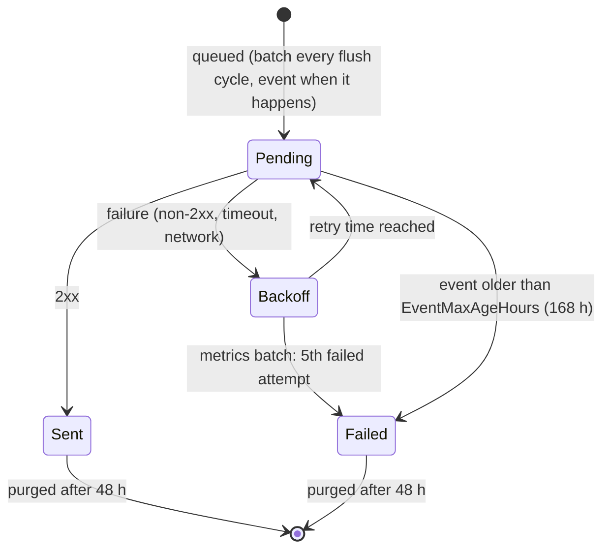

# 10 Reliability

[Portal API guide](README.md) › Reliability

## The outbox

Metrics batches and events go through a durable queue in the agent's SQLite database before they
are sent. Commands and configuration don't. They are polled, and their acknowledgements and
results have their own retry rules (see below).

| Property | Metrics batch | Event |
| --- | --- | --- |
| Priority | 0 | 1 (sent first) |
| Idempotency key | `batchId` (post-1.0.18) | `eventId` |
| Backoff after the n-th failure | `RetryBackoffSeconds × n` = 60, 120, 180, 240 s | 30 s × 2ⁿ⁻¹, capped at 15 min |
| Gives up | after `MaxRetryAttempts` (5) failed attempts | when older than `EventMaxAgeHours` (168 h) |
| Survives agent restarts | yes | yes |

Each flush cycle (default every 30 s):

1. take up to `MaxBatchSize` (500) messages that are due, highest priority first, then oldest
   first;
2. send them one by one, one HTTP request each;
3. at the **first failure**, record an attempt for that message only, and end the cycle. The rest
   are untouched and are tried again next cycle.

### Guarantees and non-guarantees

- **At least once.** A message is removed only after a 2xx. A 2xx lost on the way back (timeout
  after your portal stored it) means the message is sent again. Deduplicate.
- **Not exactly once, not in order.** Events go before metrics. A message in backoff is overtaken
  by newer ones. Two agents' clocks differ. Always order by the timestamps in the payload.
- **Bounded for metrics.** A batch that failed five times is dropped. Its CPU/RAM samples never
  reach the portal (disk, service and other snapshots are repeated in later batches anyway).
  Expect gaps in CPU/RAM history after long portal outages.
- **A week for events.** Incidents survive a portal outage of up to seven days.

### The portal is down for an hour, a day, a week

While the portal fails, every flush cycle still queues a new batch, and the oldest due message
gets one failed attempt per cycle. With one attempt per cycle and batches waiting longer and
longer between attempts, how long a particular batch survives depends on how many messages are
queued. The agent doesn't promise any figure. In practice:

| Outage | What reaches the portal afterwards |
| --- | --- |
| a few minutes | everything: all batches and events, delivered in a burst |
| hours | all events; most batches, with gaps where batches ran out of attempts |
| days (up to 7) | all events; CPU/RAM history largely missing; current snapshots and the agent object as soon as the next batch gets through |
| more than 7 days | events older than 7 days are dropped too |

When the portal comes back, the agent sends up to 500 queued messages per cycle, one request at a
time, as fast as your portal answers. Your portal sees a burst of old timestamps. It MUST accept
them and SHOULD update "current state" only from data newer than what it has.

### Backpressure

If your portal is overloaded, answering `429` or `503` quickly is the correct reaction. The agent
stops at that message and tries again next cycle (it ignores `Retry-After`). That limits each
agent to one failed request per 30 s cycle, but it also spends retry attempts: batches refused
five times are lost. Prefer scaling out over refusing for long periods.

## Commands and configuration under failure

| Message | Retried? | Effect of a long portal outage |
| --- | --- | --- |
| command poll | next cycle | commands issued during the outage are picked up afterwards, unless older than 60 min (then dropped by the agent) |
| command acknowledgement | no | lost; the result still comes |
| command result | every poll cycle, no limit, survives restarts | delivered afterwards |
| config fetch | next cycle | applied afterwards |
| config acknowledgement | every config cycle until 2xx, survives restarts | delivered afterwards |

## Agent restarts

Restarts (updates, AgentRestart, reboots, crashes) lose nothing that was queued: the outbox,
command records and results, and the applied configuration version are in the agent's database.

- `agent.startedAt` and `agent.uptimeSeconds` reset.
- A command that was executing when the agent stopped is reported as failed at the next start.
- After a machine reboot the agent sends a ServerRestarted event (type 16).
- The CPU and RAM samples taken while the agent was stopped don't exist: expect a gap.

## Clock skew

All timestamps come from the server's clock, which can be wrong.

- Agent-generated timestamps (`timestamp`, `batchedAt`, `acknowledgedAt`, `executedAt`) are stored
  as received. A portal MAY record its own receive time next to them, and SHOULD NOT reject data
  for being "in the future". Clamp for display if needed.
- Portal-generated timestamps the agent checks: `issuedAt` (rejected when more than 300 s in the
  future or older than 3600 + 300 s by the agent's clock) and `scheduledAt` (run when the agent's
  clock reaches it). A server whose clock is off by more than 5 minutes drops every command
  silently. Detect it by comparing `agent.startedAt + uptimeSeconds` or `batchedAt` with your
  receive time (allowing for delivery delay), and warn the user.
- `maintenance.untilUtc` is evaluated with the agent's clock.

## Scaling a portal

Load per agent with default settings:

| Request | Rate per agent | Typical body |
| --- | --- | --- |
| metrics batch | 2 / min | 2 to 10 KB |
| command poll | 2 / min | none (204) |
| config poll | 0.2 / min | none (204) |
| events | rare; bursts during incidents | < 2 KB |

That's roughly 4.2 requests/min per agent. 10 000 agents is about 700 requests/s, mostly tiny
GETs answered with 204. Tips:

- Make `commands/pending` and `config` cheap: an indexed lookup or a cache keyed by agent, with a
  204 fast path. Your remote configuration can lower poll frequency for large fleets
  (`portal.commandPollIntervalSeconds`).
- Accept writes fast and process them asynchronously: validate, deduplicate on `batchId`/`eventId`
  with a unique index, store the raw body and acknowledge. Aggregate in the background.
- Agents are not synchronised, but after a portal outage or a network change many come back at
  once. Size for the replay burst (500 messages per agent per cycle).
- No session affinity is needed. Every request is self-authenticating.
- Storage sizing (CPU + RAM at 5 s): about 34 560 samples per agent per day, about 1 to 2 MB/day
  uncompressed in a row store, much less in a time-series store. Snapshots: store only on change.
  Events: a few KB per agent per day. Plan retention and downsampling.
- Index events by `(agent, timestamp)` and `(agent, alertKey)`; commands by `(agent, state)`.
